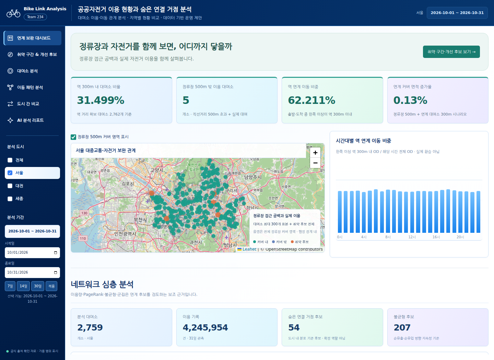
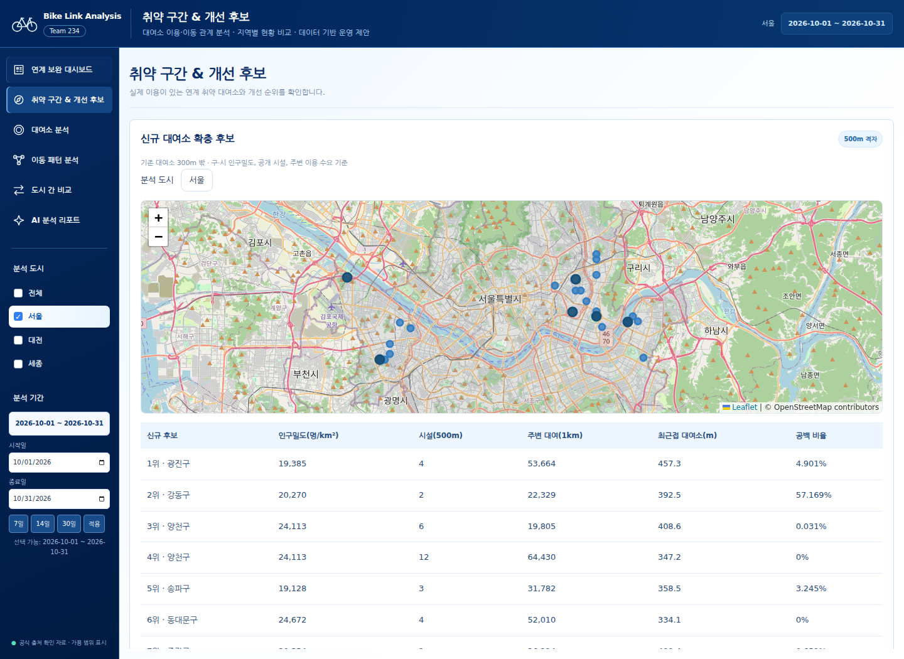
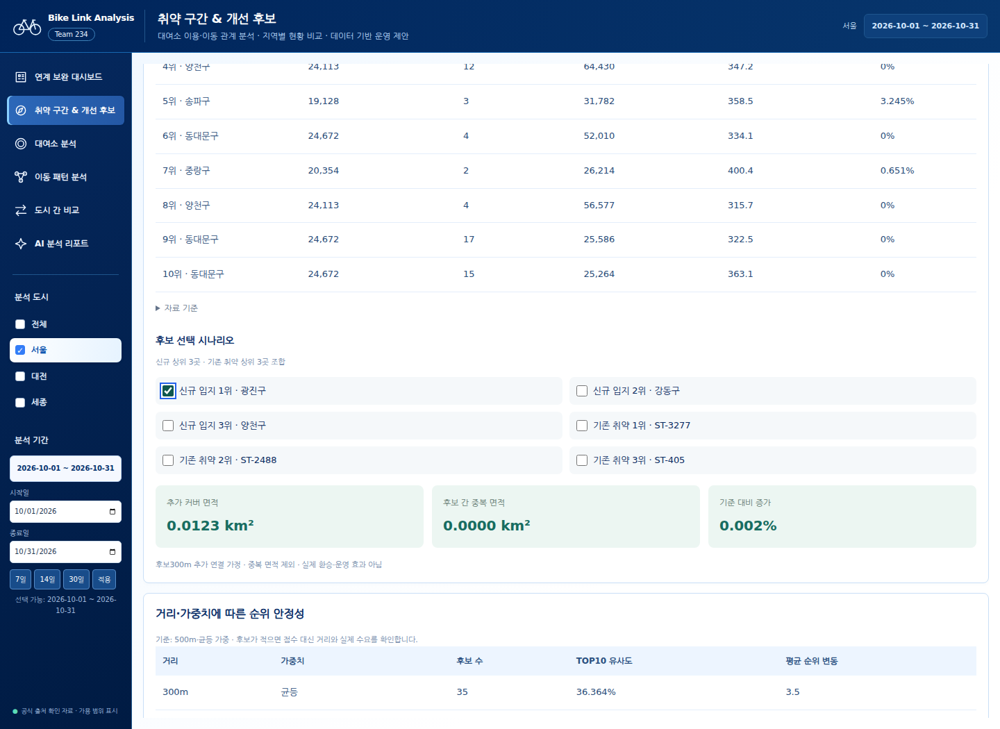

# Bike Link Analysis

## 1. 프로젝트 이름

### Bike Link Analysis — 공공자전거와 대중교통 연결 공백 분석

**한 줄 설명:** 서울·대전·세종의 공공자전거 이용 이력과 정류장·인구·시설 자료를 결합해 대중교통 접근 공백을 찾고, 대여소 확충·재배치 검토 후보를 시각화하는 데이터 분석 서비스입니다.

빅데이터개론 프로젝트로, 단순히 “어느 대여소가 많이 이용되는가”를 보여주는 것에서 출발해 **“공유자전거가 대중교통 연결을 어떻게 보완하며, 어디를 우선 검토해야 하는가”**를 설명하는 것을 목표로 합니다.

현재 주 사용 화면은 **WIZ Angular**입니다. 별도 실행 가능한 **React + FastAPI** 구성도 보존하며, 분석 결과는 SQLite와 파일로 관리합니다. Upstage Solar는 실제 분석 도구의 결과를 근거로 설명을 작성합니다.

### 어떤 문제를 다루는가

| 질문 | 분석 방법 | 제공 결과 |
|---|---|---|
| 정류장 접근이 어려운데 실제 자전거 수요가 있는 곳은 어디인가? | 최근접 정류장 거리와 관측 대여량 결합 | 기존 대여소 중 취약 후보·선정 근거 |
| 대여소가 아예 없는 곳은 어떻게 찾는가? | 500m 격자에 인구밀도·공개 시설·주변 수요·접근 공백 결합 | 신규 입지 검토 격자와 근거 수치 |
| 후보 여러 곳을 선택하면 커버 영역은 얼마나 달라지는가? | 후보 300m 버퍼의 합집합에서 기존 커버 영역 제외 | 추가 면적·중복 면적·증가율 |
| 확충과 재배치는 어떻게 다른가? | 입지 후보와 시간대 대여·반납 흐름을 분리 | 확충 검토·재배치 검토 목록 |
| 이용량만으로 드러나지 않는 대여소 역할은 무엇인가? | PageRank·군집화·유사도·불균형 분석 | 연결 중요도·시간대 패턴·운영 검토 근거 |

### 실제 연결한 자료와 범위

| 자료 | 현재 분석 범위 | 주의할 점 |
|---|---|---|
| 서울 따릉이 | 2026-10-01~31, 집계 이동 4,245,954건 | 개별 Trip이 아닌 대여소 간 집계 OD |
| 대전 타슈 | 2025-12-01~2026-10-31, 유효 Trip 7,605,738건 | 월별 대용량 이력과 SQLite 집계 |
| 세종 어울링 | 2025-10-01~31, 유효 Trip 259,143건 | 2020~2025 원본 ZIP 중 한 달만 서비스에 연결 |
| 버스·철도 정류장 | 서울 17,422 / 대전 3,281 / 세종 3,035행 | 도시명·주소 분류 기준. 중복 좌표는 면적에서 중복 계산하지 않음 |
| 인구·시설·경계 | 2026-10 구·시 인구밀도, 공개 도서관·개방시설, SGIS 2020 경계 | 실측 격자인구·생활시설 전수 자료가 아니며 기준 시점이 다름 |
| 세종 위치 마스터 | 이력 ID 728개 중 726개 연결 | 2026-05 위치와 2025-10 이용 이력의 시점 차이, 미매칭 2개 보존 |

서로 다른 연도의 총량을 같은 기간처럼 합치지 않습니다. 서울·대전의 공통 비교에 세종 2025년 10월을 포함하지 않으며, 세종은 단독 선택으로 확인합니다. 모든 값은 확보된 자료와 선택 기간 기준입니다.

[데이터 출처](docs/DATA_SOURCES.md) · [정류장 통합](docs/transit_stops_sources.md) · [세종 상세 이력](docs/SEJONG_DETAILS_20261116.md) · [입지·경계·세종 위치 마스터](docs/PLANNING_IMPROVEMENTS.md)

## 2. 사용한 기술

### 언어·프레임워크·도구

| 구분 | 기술 | 사용 목적 |
|---|---|---|
| 백엔드 언어 | Python | 수집·정규화·통계·그래프·공간 분석·배치 처리 |
| API 서버 | FastAPI, Pydantic, Uvicorn | REST API, 요청·응답 검증, 개발 서버 실행 |
| 서비스 화면 | WIZ, Angular, TypeScript, Pug, SCSS | 현재 사용하는 통합 분석 화면과 Python API 어댑터 |
| 독립 프론트엔드 | React 19, TypeScript, Vite | 별도 실행 가능한 대시보드·분석 UI |
| 스타일 | Tailwind CSS, CSS, SCSS | 화면 구성·반응형 레이아웃·표·카드 스타일 |
| 지도 | Leaflet, React Leaflet, OpenStreetMap 타일 | 대여소·정류장·전체 커버 영역·후보 시나리오 표시 |
| 차트 | Recharts, SVG | 시간대 패턴, 비교 지표, 시나리오 변화 시각화 |
| 데이터 처리 | pandas, CSV·JSON, openpyxl | 표 데이터 처리·엑셀 읽기·정규화 |
| 저장·조회 | SQLite | 대용량 이력 집계와 도시·기간별 분석 결과 저장 |
| 머신러닝 | scikit-learn | K-means, StandardScaler, 코사인 유사도, Silhouette·ARI |
| 그래프 분석 | NetworkX | 방향 그래프, 가중 PageRank·차수·표본 매개 중심성 |
| 공간 분석 | Shapely, pyproj | 버퍼 합집합·경계 클리핑·좌표 변환·GeoJSON 단순화 |
| 대용량 배치 | PySpark, Java — 선택형 | 대전 원본 이력의 분산 처리 방식 집계·독립 검산 |
| AI 보고서 | Upstage Solar, OpenAI Python SDK 호환 클라이언트 | 실제 도구 호출·근거 설명·일부 수치와 ID 대조 |
| 수집·통신 | HTTPX, Requests | 공식 공개 자료 수집·API 통신·준비 상태 확인 |
| 테스트 | pytest, FastAPI TestClient, Playwright·Chromium | 계산·API 회귀 테스트와 실제 브라우저 확인 |
| 형상·재현 관리 | Git, GitHub, SHA-256 manifest | 코드 이력·공개 자료 보존·입력 내용과 집계 버전 검증 |

### 핵심 분석 방법

- **거리와 접근성:** haversine으로 대여소와 정류장 사이의 직선거리를 계산합니다. 기존 취약 후보는 최근접 정류장 거리 >500m, 선택 기간 실제 대여량 >0인 대여소입니다.
- **전체 지도:** 모든 도시 분류 정류장의 500m 버퍼 합집합을 행정 경계로 자릅니다. 화면에는 2m 허용오차로 단순화한 도형을 표시하며 면적은 단순화 전 도형으로 계산합니다.
- **신규 입지:** 기존 대여소 300m 밖의 500m 격자에 구·시 인구밀도, 시설, 주변 관측 대여량, 정류장 접근 공백을 결합합니다. 예측 이용량이나 설치 확정지로 해석하지 않습니다.
- **순위 검증:** 접근성 결손·수요·잠재 추가 면적을 각각 한 번 반영합니다. 거리 300/500/800m와 가중치 3조건의 총 9조건에서 TOP10 유사도와 순위 변동을 비교합니다. 후보가 5개 미만이면 점수보다 근거 수치를 강조합니다.
- **선택 시나리오:** 신규 상위 3곳과 기존 취약 상위 3곳까지의 부분집합을 사전 계산합니다. 후보별 면적을 단순 합산하지 않고 겹치는 영역을 제외합니다.
- **네트워크·군집:** PageRank·가중 차수·군집 품질·기간 안정성과 유사 대여소를 함께 검토합니다. 낮은 군집 품질을 숨기거나 중심성만으로 역할을 확정하지 않습니다.
- **불균형:** `순유출 = 대여 - 반납`으로 통일합니다. 시간대 흐름과 관측량·확보된 거치 용량은 보여주되 재고가 없는 상태에서 실제 부족이나 이동 수량을 생성하지 않습니다.

[분석 공식과 제한](docs/PLANNING_IMPROVEMENTS.md) · [보고서·서비스 정합성](docs/report_service_reconciliation.md)

### 처리 구조


현재 준비 기록은 **27개 도시·기간 조합 × 8개 액션 = 216개 집계 결과**입니다. WIZ 핵심 지표·취약도·입지 시나리오는 저장값을 조회하며 미준비 기간을 실시간 계산이나 다른 기간의 값으로 대체하지 않습니다.

## 3. 실행 화면

아래 이미지는 **2026-11-16 이번 README 작성 과정에서 현재 WIZ 서비스를 Chromium으로 직접 실행하고 캡처한 화면**입니다. 화면을 새로 그린 목업이 아닙니다. React 독립 화면은 구성과 배치가 다를 수 있습니다.

### 연계 보완 대시보드

도시·분석 기간을 선택하고 역 인접 대여소 비율, 정류장 접근 밖 실제 이용 대여소, 역 연계 이동 비중, 공간 커버 증가율을 확인합니다. 지도에는 전체 정류장 커버 도형과 대여소를 구분해 표시합니다.



역 연계 이동 비중은 한쪽 이상 역 300m 내인 OD 비중이며 실제 환승률이 아닙니다. 지도에서 대여소 점은 표시 성능을 위한 표본일 수 있으나 커버 도형은 전체 정류장으로 계산합니다.

### 신규 입지·취약 후보·운영 검토

기존 대여소의 취약 후보와 대여소가 없는 지역의 신규 입지 격자를 별도로 보여줍니다. 인구밀도·시설·주변 관측 수요와 순위 안정성을 확인하고, 확충과 재배치의 근거를 구분합니다.



### 후보 선택 시나리오

후보 체크박스를 선택하면 미리 계산된 조합을 조회해 추가 커버 면적, 후보 간 중복 면적, 기존 대비 증가율을 바꿔 표시합니다.



이번 캡처에서는 서울의 첫 신규 입지 후보를 선택한 뒤 **추가 면적 0.0123km²** 표시를 확인했습니다. 이 값은 해당 후보·기간·자료 버전의 공간 시나리오이며 실제 환승 증가나 설치 효과가 아닙니다.

[모바일 실제 화면](docs/screenshots/readme-20261116/planning-mobile.png) · [이번 실행 확인 기록](docs/screenshots/readme-20261116/verification.json)

이번 화면 확인에서 신규 입지 10행, 민감도 9조건, 재배치 검토 10행과 선택 시 면적 변화를 확인했습니다. 페이지 오류와 모바일 가로 넘침은 없었고, 유료 Solar 생성 요청은 실행하지 않았습니다.

### 기존 실제 자료 검증 기록

| 기본 분석 기간 | 신규 입지 검토 격자 | 기존 취약 대여소 | 후보 선택 조합 |
|---|---:|---:|---:|
| 서울 2026-10 | 842개 | 5개 | 64개 |
| 대전 2025-12~2026-10 | 484개 | 1개 | 16개 |
| 세종 2025-10 | 198개 | 4개 | 64개 |

이 표는 기존 전체 데이터 배치 기록이며 이번 README 작업에서 전체 원본을 다시 계산한 결과는 아닙니다. 신규 격자는 설치 허가·토지·도로·예산 검토 전 후보입니다.

[실제 자료 검증](docs/transit/planning-validation.json) · [216개 배치 기록](docs/transit/planning-build.json)

## 4. 실행 방법

### 실행 전 알아둘 점

- Python 3.11+와 Node.js 20+가 필요합니다.
- React 독립 화면은 이 저장소만으로 프론트엔드를 실행할 수 있습니다. WIZ 화면은 기존 WIZ·portal/season·부모 화면 통합이 필요합니다.
- **실제 분석 데이터와 처리 DB는 Git에 포함하지 않습니다.** 새 환경에서는 원본 수집·정규화와 집계 준비가 필요합니다. 데이터가 없는 상태는 기존 화면과 같은 분석 결과를 제공하지 않습니다.
- Spark는 선택 기능입니다. 기본 서비스에 Java나 Spark를 설치할 필요는 없습니다.
- 아래 명령은 저장소 루트에서 실행합니다. 가상환경 활성화 후에는 같은 Python 환경을 유지합니다.

### 4-1. 저장소 내려받기와 Python 환경

```bash
git clone https://github.com/xericen/bike-link-analysis.git
cd bike-link-analysis

python -m venv .venv

# Linux / macOS
source .venv/bin/activate

# Windows PowerShell에서는 위 활성화 명령 대신:
# .\.venv\Scripts\Activate.ps1

python -m pip install -r backend/requirements.txt
# 입지 자료 수집·배포 후 URL 점검에 사용하는 추가 HTTP 클라이언트
python -m pip install requests
cp .env.example .env
```

Windows PowerShell에서는 `cp` 대신 `Copy-Item .env.example .env`를 사용할 수 있습니다. Windows에서의 전체 수집·Spark 실행은 이번 작업에서 검증하지 않았습니다.

### 4-2. 환경변수와 비밀정보

로컬 `.env`에 필요한 값을 직접 입력합니다. 키를 README·소스·캡처에 붙여 넣지 않습니다.

| 변수 | 용도 | 필요 조건 |
|---|---|---|
| `UPSTAGE_API_KEY` | Solar 보고서 생성 | 유료 모델 설명을 사용할 때 |
| `UPSTAGE_MODEL` | 기존 예시의 Solar 모델 설정 | 환경의 기존 설정·접근 권한에 맞게 사용 |
| `DATA_GO_KR_API_KEY` | 선택형 공공데이터 OpenAPI | 활용신청·인증이 필요한 수집 경로 사용 시 |
| `BIKE_DATABASE_URL` | 향후 PostgreSQL 전환용 예시 | 현재 분석 저장소는 SQLite·파일 |

Solar 키가 없으면 AI 기능은 설정 안내를 반환합니다. 이미 준비된 일반 분석 화면과 데이터 조회를 위해 유료 AI 요청을 실행할 필요는 없습니다.

`.env`와 변형 파일, 개인키, `data/raw/`, `data/processed/`, `data/solar-audit/`, 가상환경·빌드 결과는 제외합니다. `빅데/`에는 사용자가 기존에 공개 업로드한 보고서와 전국 정류장 원본을 보존합니다.

### 4-3. 실제 데이터 준비

**① 서울·대전 기본 이력 수집과 정규화**

```bash
python -m scripts.collect.collect_all
python -m scripts.preprocess.normalize
python -m scripts.preprocess.map_seoul_stations
python -m scripts.preprocess.validate_stage3
```

공식 다운로드에 네트워크·저장 공간이 필요하며 제공 경로 변경이나 접근 제한이 생길 수 있습니다. 실패하면 임의 데이터로 대체하지 말고 [출처 문서](docs/DATA_SOURCES.md)의 로컬 원본 입력 방법과 [서울 자료 전환 기록](docs/SEOUL_DATASET_TRANSITION.md)을 확인합니다.

**② 전국 버스·철도 정류장 통합**

`빅데/`의 CSV·XLSX를 실제 경로로 지정합니다. 아래 꺾쇠 부분은 파일 경로로 바꿔야 합니다. 한글 업로드 파일은 자모 분해형 이름일 수 있으므로 터미널 자동완성으로 선택하는 것이 안전합니다.

```bash
python -m scripts.preprocess.integrate_transit_uploads \
  --bus "<빅데 폴더의 전국 버스 CSV 실제 경로>" \
  --rail "<빅데 폴더의 도시철도 XLSX 실제 경로>" \
  --report docs/transit/local-transit-integration.json

python -m scripts.preprocess.build_transit_linkage \
  --seoul-od data/raw/seoul-od-202610.zip \
  --daejeon-trips data/processed/trips \
  --report docs/transit/local-linkage-integration.json
```

버스 도시명 분류, 철도 복합키 중복 처리, 경계 밖 좌표 보존 정책은 [정류장 통합 문서](docs/transit_stops_sources.md)를 따릅니다.

**③ 세종 상세 이용 이력 연결**

```bash
python -m scripts.collect.collect_sejong_details
python -m scripts.preprocess.normalize_sejong_details \
  --zip data/raw/sejong-details-15106191.zip \
  --start 2025-10-01 --end 2025-10-31 \
  --report docs/transit/local-sejong-details.json
```

전체 6년을 처리하는 명령이 아닙니다. 기존 세종 상세 자료의 덮어쓰기를 막는 조건이 있으므로 재실행 전 [세종 자료 문서](docs/SEJONG_DETAILS_20261116.md)를 확인합니다.

**④ 인구·시설·행정경계·세종 위치 마스터 준비**

```bash
python -m scripts.collect.planning_sources
```

공식 인구·시설 자료와 행정 경계를 수집하고 세종 위치 마스터를 기존 이력 ID에 연결합니다. 자료 기준일과 과거 위치의 불확실성은 [입지 분석 문서](docs/PLANNING_IMPROVEMENTS.md)에 기록합니다. 이 단계가 입력을 변경하므로 최종 집계 전에 실행합니다.

### 4-4. 분석 결과 사전 집계

```bash
python -m scripts.preprocess.precompute_city_kpis \
  --workers 2 \
  --report docs/transit/local-kpi-build.json
```

배치는 도시·기간별 8개 액션을 준비하고 입력 내용의 SHA-256 manifest를 만듭니다. 기본 준비 기록은 27조합·216개입니다. 대용량 자료·공간 연산 때문에 시간이 걸릴 수 있으며 생성 시간과 화면 조회 시간은 다릅니다.

별도 사용자 지정 기간이 필요하면 다음과 같이 명시합니다.

```bash
python -m scripts.preprocess.precompute_city_kpis \
  --city daejeon --start 2026-09-01 --end 2026-10-31 \
  --workers 2 --report docs/transit/local-custom-period.json
```

준비하지 않은 기간은 **409 안내**를 반환하며 화면에서 준비 기간으로 이동할 수 있습니다. 자료·코드가 바뀌면 해당 버전의 결과를 다시 생성해야 합니다.

다른 서버에 소스·입력·집계 DB·manifest를 복사한 뒤에는 재계산 없이 내용 검증을 수행할 수 있습니다.

```bash
python scripts/deploy/release.py --verify-only
```

내용이 동일하면 수정시각이 달라도 같은 집계를 검증합니다. 내용이 바뀌었으면 검증이 실패하며 재생성이 필요합니다. 요청마다 거대 DB를 해시하지 않고 검증 영수증과 로컬 변경 여부를 검사합니다.

`scripts/deploy/release.py`를 옵션 없이 실행하면 집계 생성 후 검증까지 수행합니다. 실제 배포 명령은 `--` 뒤에 전달할 때만 실행하며, 생성·필수 도시·모든 액션 검증 실패 시 후속 명령을 실행하지 않습니다. 외부 CI/CD를 자동 연결하는 기능은 아닙니다.

[집계 운영](docs/PRECOMPUTED_KPIS.md) · [내용 기반 배포 검증](docs/PLANNING_IMPROVEMENTS.md)

### 4-5. FastAPI와 React 실행

**터미널 A — API 서버**

```bash
# 저장소 루트, 가상환경 활성화 상태
uvicorn backend.main:app --host 127.0.0.1 --port 8000
```

**터미널 B — 프론트엔드**

```bash
cd frontend
npm ci
npm run dev
```

브라우저에서 보통 `http://localhost:5173`에 접속합니다. Vite가 `/api`를 `http://127.0.0.1:8000`으로 프록시합니다.

| 확인 주소 | 역할 |
|---|---|
| `http://localhost:5173` | React 독립 화면 |
| `http://127.0.0.1:8000/docs` | FastAPI 대화형 API 스키마 |
| `http://127.0.0.1:8000/api/health` | 서버 생존 확인 |
| `http://127.0.0.1:8000/api/readiness` | 입력·사전 집계 준비 상태 |

### 4-6. WIZ 화면 실행과 사용 순서

현재 README 캡처는 WIZ 화면입니다. [WIZ 통합 안내](integrations/wiz/README.md)에 따라 전용 컴포넌트·지도 스타일을 기존 WIZ 프로젝트에 배치하고, 저장소를 WIZ 프로젝트의 `bike-link-analysis/` 경로에서 사용할 수 있게 준비합니다. 일반 React 빌드가 WIZ를 빌드하지는 않습니다.

사용 순서는 다음과 같습니다.

1. 도시와 **실제로 준비된 분석 기간**을 선택합니다.
2. 연계 보완 대시보드에서 지표·전체 커버 도형·시간대 역 연계 비중을 확인합니다.
3. ‘취약 구간 & 개선 후보’에서 기존 후보와 신규 입지 격자의 근거를 비교합니다.
4. 후보를 선택·해제해 추가 면적과 중복 면적의 차이를 확인합니다.
5. 거리·가중치 9조건의 민감도를 확인하고 후보가 적을 때 점수를 과도하게 해석하지 않습니다.
6. 대여소 상세·이동 네트워크·도시 비교에서 기존 이용 패턴과 연결 구조를 확인합니다.
7. 필요한 경우에만 Solar 질문을 전송하고 도구·기간·실제 근거 카드·답변 검증 상태를 함께 확인합니다. 모델 호출에는 사용량이 발생합니다.

### 4-7. 테스트·빌드·선택형 Spark

```bash
# 저장소 루트
python -m pytest backend/tests -q
python -m compileall -q backend scripts

# React 프로덕션 빌드
cd frontend
npm run build
```

이번 작업에서는 **74개 테스트 통과·경고 7건**, React TypeScript/Vite 빌드 통과를 확인했습니다. 경고는 pytest/TestClient 호환과 Shapely 변환 API 폐기 예정 안내입니다. 실제 브라우저 캡처도 수행했지만 전체 원본 재집계·유료 Solar 생성·서비스 배포는 수행하지 않았습니다.

대전 대용량 원본을 선택형 Spark 배치로 처리하려면 Java 17+와 별도 의존성을 준비합니다.

```bash
# 저장소 루트, Java 설치 및 환경 설정 후
python -m pip install -r backend/requirements-spark.txt
python -m scripts.preprocess.spark_tashu \
  --raw-zip data/raw/15137219.zip \
  --output data/processed/spark-new-run
```

기존 SQLite를 자동 교체하지 않으며 새 출력 경로와 독립 검산을 사용합니다. [Spark 재현·검증](docs/SPARK_TASHU_PIPELINE.md)

### 저장소 구성

| 경로 | 내용 |
|---|---|
| `backend/analysis/` | 군집·유사도·네트워크·공간·입지 계산 |
| `backend/services/` | 데이터 조회·사전 집계·manifest·배포 준비 상태 |
| `backend/agents/` | Solar 도구와 근거·응답 검증 |
| `backend/tests/` | fixture 기반 단위·API 회귀 테스트 |
| `frontend/` | React 독립 화면 |
| `scripts/collect/`, `scripts/preprocess/` | 자료 수집·정규화·집계 |
| `scripts/deploy/`, `scripts/validate/` | 배포 전 확인·별도 검증 도구 |
| `integrations/wiz/` | WIZ 전용 화면 보관본·통합 조건 |
| `docs/` | 출처·산정식·실행 증거·화면 |
| `빅데/` | 기존 업로드 보고서·검증 문서·전국 정류장 원본 |

## 5. 만든 이유, 목표

### 만든 이유

대여량이 많은 대여소가 반드시 대중교통 접근성이 부족한 곳을 보완하는 것은 아닙니다. 반대로 이용량 순위가 낮아도 이동 네트워크에서 중요한 연결을 담당할 수 있습니다. 또 기존 대여소만 분석하면 대여소가 아예 없는 지역은 후보에서 빠집니다.

이 프로젝트는 이용량·연결 구조·정류장 접근성·신규 입지 조건을 함께 살펴보고, **후보가 왜 선택됐는지 실제 수치와 자료로 설명하는 과정**을 만들기 위해 시작했습니다. AI 보고서도 근거 없이 추천을 생성하기보다 계산된 결과와 한계를 설명하도록 연결했습니다.

### 프로젝트 목표

1. **실제 자료 기반 분석:** 원본 출처·스키마·기간·품질을 기록하고 미확보 지표는 만들지 않습니다.
2. **대중교통 연결 공백 탐색:** 정류장과 기존 대여소의 관계를 전체 커버 도형과 거리로 확인합니다.
3. **신규 확충 검토:** 기존 대여소가 없는 격자도 인구·시설·관측 수요를 근거로 검토합니다.
4. **확충과 재배치 구분:** 시설 위치 문제와 시간대 수요 불균형을 다른 의사결정으로 다룹니다.
5. **설명 가능한 후보 비교:** 근거 수치·민감도·겹치는 면적을 공개해 점수를 검토할 수 있게 합니다.
6. **재현 가능한 서비스:** 계산은 배치에서 수행하고, 화면은 내용 검증이 끝난 저장값을 조회하도록 구성합니다.

### 구현하며 배운 점

| 학습 주제 | 프로젝트에서 확인한 점 |
|---|---|
| 대용량 데이터 처리 | 원본 전체를 한 번에 메모리에 올리는 대신 월별 처리·SQL 집계·선택형 Spark를 적용해야 합니다. |
| 데이터 품질·조인 | 도시별 ID·명칭·좌표·기준일이 달라 정확한 키와 미매칭 보존이 필요합니다. |
| 그래프·군집 해석 | 중심성 순위는 설정과 모집단에 따라 달라지고, 군집의 분리도가 낮으면 역할 설명을 보류해야 합니다. |
| 수치 정밀도 | 서울 불균형 후보 208→207 차이를 통해 판정 전 반올림이 경계값을 바꿀 수 있음을 확인했습니다. |
| 공간 시각화 | 표본 정류장으로 만든 음영은 전체 공백처럼 오해될 수 있어 전체 합집합·경계 클리핑·단순화 오차를 구분해야 합니다. |
| 점수·민감도 | 수요가 여러 항목에 중복 반영되는지, 후보가 한 곳일 때 상대 점수가 무엇을 뜻하는지 점검해야 합니다. |
| 성능·배포 | 요청 중 무거운 공간 분석을 수행하기보다 버전이 맞는 결과를 사전 생성하고 배포 전에 전수 조회를 검증해야 합니다. |
| AI 검증 | 숫자가 근거에 존재하는 것과 문장의 의미가 정확한 것은 다릅니다. 실제 도구 결과·답변·원문 보류를 구분해야 합니다. |

### 현재 한계와 다음 검토 과제

- **공간 시나리오는 잠재 접근 범위입니다.** 실제 도보 경로·환승 증가·인구 증가·설치 효과를 측정한 결과가 아닙니다.
- 인구는 구·시 밀도이므로 격자별 실측 인구 차이를 설명하지 못합니다. 시설 레코드도 고유 건물이나 생활시설 전수와 같지 않습니다.
- 자료 기준일이 다릅니다. 경계는 2020년, 인구는 2026년 10월, 세종 위치는 2026년 5월이며 2025년 10월 과거 위치 동일성을 확인하지 못했습니다.
- 재고·운영 이동 기록이 없으므로 부족 자전거 수나 실제 재배치 수량을 생성하지 않습니다.
- 서울 한 달 자료로 계절 안정성을 확정하지 않습니다. 서로 다른 도시·기간의 총량이나 상대 점수를 하나의 순위로 합치지 않습니다.
- Solar의 일부 수치·ID·극값 검사는 자유 서술 전체의 정확성을 보증하지 않습니다. 근거 카드·출처·검증 상태를 함께 확인해야 합니다.

향후에는 동일 시점의 상세 인구·보행망·설치 가능 토지·실시간 재고와 운영 기록을 확보해 입지 적합성과 실제 운영 효과를 검증하는 것이 필요합니다.

[최신 입지 분석·한계](docs/PLANNING_IMPROVEMENTS.md) · [실제 수치 검증](docs/transit/planning-validation.json) · [Solar 검증 범위](docs/SOLAR_RECOVERY_20261112.md)
