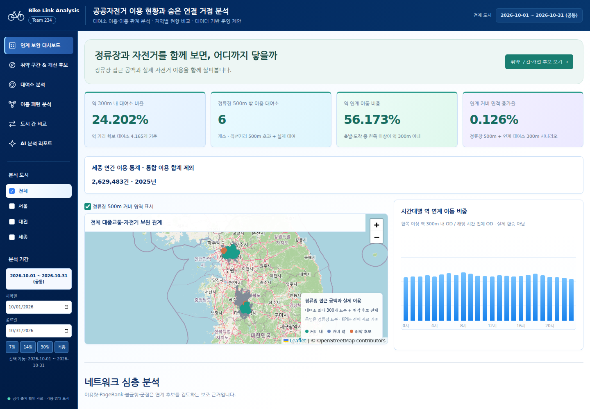
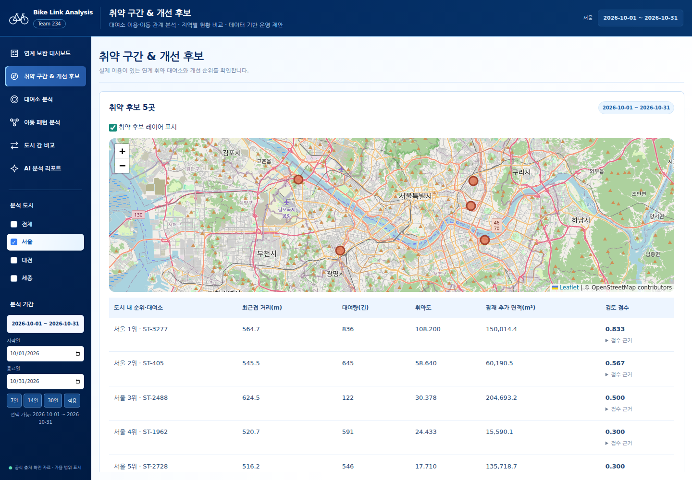
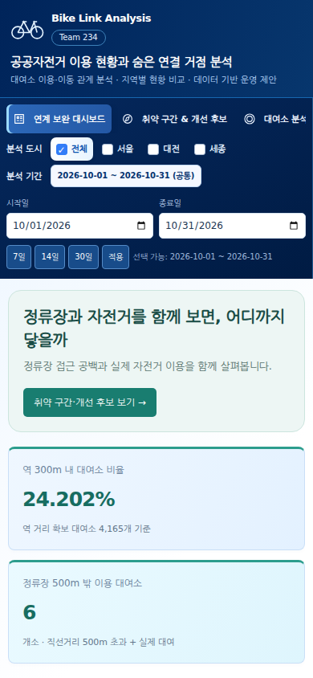
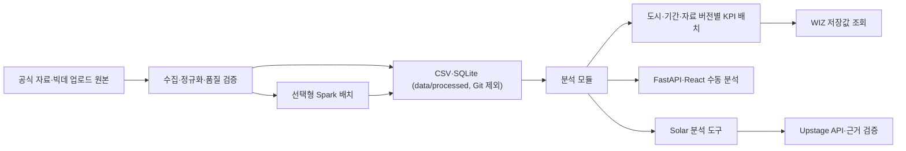

# Bike Link Analysis

**팀 234 · 공공자전거 데이터 기반 도시별 대중교통 연계 취약 구간 탐지 및 개선 효과 검증**

서울·대전·세종의 실제 확보 자료로 대여소 이용 패턴, OD 이동 네트워크, 대중교통 접근성을 분석하는 FastAPI + SQLite 프로젝트입니다. 현재 서비스 화면은 **WIZ Angular**, 별도 실행 가능한 프론트엔드는 **React + Vite**입니다. Upstage Solar는 분석 도구의 실제 결과를 근거로 보고서를 작성합니다.

핵심 질문은 **“공유자전거가 대중교통 연결 부족을 얼마나 보완하며, 확충·재배치 검토가 필요한 지역은 어디인가?”**입니다. 직선거리 버퍼의 공간 커버 시나리오를 실제 환승률 증가나 운영 성과의 인과 효과로 해석하지 않습니다. 미확보 값은 N/A로 표시하고, 합성 자료는 별도 Demo Mode로 분리합니다.

## 최신 상태 — 2026-11-16

| 항목 | 현재 연결 범위 | 해석·제약 |
|---|---|---|
| 서울 따릉이 | 2026-10-01~31, 이동 4,245,954건 | 개별 Trip이 아닌 집계 OD |
| 대전 타슈 | 2025-12-01~2026-10-31, 유효 Trip 7,605,738건 | 실제 이력을 월별 처리·SQLite 집계 |
| 세종 어울링 | 2025-10-01~31, 유효 Trip 259,143건 | 원본 2020~2025 ZIP 중 한 달만 연결. 대여소명·좌표 미확보 |
| 전국 정류장 통합 | 서울 17,422 / 대전 3,281 / 세종 3,035행, 합계 23,738행 | 버스 도시명·철도 주소 기준. 행정경계의 전수 검증과 다름 |
| 서울 불균형 후보 | **207개** | 판정은 반올림 전 값, 반올림은 화면 표시에만 적용 |
| 연계 취약 후보 | 서울 2026-10 **5개**, 대전 2026-10 **1개** | 최근접 정류장 거리 >500m AND 실제 대여량 >0. 세종은 좌표 미확보로 N/A |
| WIZ 핵심 지표 | 27개 도시·기간 조합 × 7개 액션 = **189개 사전 집계 결과** | 정확한 기간·자료 버전이 맞는 저장값만 조회 |

서울·대전의 2026년 10월 공통 비교에 세종의 2025년 10월을 합산하지 않습니다. 세종은 실제 OD·시간대 추이가 있으나 대여소 지도와 정류장 거리는 N/A입니다. 원본의 ‘환승 유무’도 정의 미검증으로 실제 환승률에 사용하지 않습니다.

불균형 후보가 과거 208개에서 207개로 바뀐 이유는 **판정 전 소수 4자리 반올림**이 ST-753 경계값을 포함시켰기 때문입니다. PageRank는 방향 그래프, 가중치, alpha=0.85, tol=1e-6, max_iter=100 등 설정을 공개합니다. 같은 ST-1481도 tol=1e-12에서는 순위가 달라지므로 설정과 무관한 고정 순위로 설명하지 않습니다.

[정류장 출처·검증](docs/transit_stops_sources.md) · [세종 상세 자료](docs/SEJONG_DETAILS_20261116.md) · [보고서·서비스 정합성](docs/report_service_reconciliation.md) · [사전 집계 운영](docs/PRECOMPUTED_KPIS.md)

## 화면

아래 이미지는 **2026-11-16 기존 실행 기록**입니다. 이번 Git 반영 작업에서 새로 촬영한 화면은 아닙니다.



| 취약 구간·개선 후보 | 모바일 대시보드 |
|---|---|
|  |  |

[모바일 후보 화면](docs/transit/candidates-cleanup-mobile.png) · [세종 화면](docs/transit/redesign-세종-dashboard.png) · [화면 개편·검증 기록](docs/GOAL_ALIGNED_REDESIGN.md)

## 주요 기능과 분석 방법

| 기능 | 제공 내용 |
|---|---|
| 연계 보완 대시보드 | 역 300m 내 대여소 비율·취약 후보 수·역 연계 OD 비중·커버 면적 증가율, 연계 지도·시간대 차트 |
| 취약 구간·개선 후보 | 후보 지도·도시 내 검토 순위·점수 근거·전후 커버 면적 차트·커버 대여소 수 |
| 대여소 분석 | 이용 패턴·코사인 유사도, 군집 품질·기간 안정성, 대중교통 연계 지표 |
| 이동 네트워크 | 전체 유효 OD 그래프의 PageRank·가중 차수·표본 매개 중심성, 숨은 거점 검토 후보 |
| 불균형 분석 | 순유출·비율·방향 반복성·평일/주말·시간대 차이 |
| 대중교통 연계 | haversine 최근접 거리, 버스·철도별 300/500m 정류장 수, 역 인접 이동 비중 |
| 운영 검토 | 목적별 후보·선정 규칙·가중치 민감도·커버 시나리오 |
| 도시 비교 | 같은 기간의 비교 가능한 비율과 자료 범위, 세종 별도 기간 안내 |
| Solar 보고서 | 도구 17개, 근거 카드·출처·기간, 일부 수치·ID·극값 검사와 실패 시 도구 요약 |

`순유출 = 대여 - 반납`이며 양수는 순유출, 음수는 순유입입니다. 재고 자료가 없으므로 불균형을 자전거 부족으로 확정하지 않습니다. K-means는 시간대 비율·이용량·결합 특징을 비교하고 Silhouette가 0.2 미만이면 유형 해석을 보류합니다. 매개 중심성은 최대 32개 노드 표본 근사입니다.

지도 정류장은 도시별 최대 600개 표본을 표시하지만 지표는 전체 정류장으로 계산합니다. 기존 역할 색상과 정류장·연계 레이어를 구분합니다.

## 데이터 처리 구조



WIZ의 `overview / research / network / centrality / dashboard_extra / vulnerability / transit_linkage`는 사전 집계값만 읽습니다. **준비하지 않은 기간이나 오래된 버전은 409 안내를 반환하며 실시간 계산으로 우회하지 않습니다.** 기존 상세 분석 경로는 유지하며, 취약도·순위 API와 Solar의 취약도·순위·시간대 연계 도구도 준비된 저장값을 조회합니다.

## 취약 후보와 공간 시나리오

- 후보는 좌표가 있는 대여소 중 **정류장까지 직선거리 >500m**, 선택 기간 실제 대여량 >0인 곳입니다. 거리·수요·점수는 전체 정밀도로 판정하고 표시만 반올림합니다.
- 기준 공간은 정류장 500m 버퍼의 합집합입니다. 그 안의 대여소에서 300m 버퍼를 한 단계 추가한 공간을 비교합니다.
- 개선 검토 점수는 도시·기간 내 취약도, 실제 수요, 개별 잠재 추가 면적의 분위수를 동등 가중합니다. 학습된 효과 계수가 아니며 도시 간 점수 순위로 합치지 않습니다.

| 도시·기간 | 후보 | 커버 면적 증가율 | 커버 대여소 수 |
|---|---:|---:|---|
| 서울 2026-10 | 5개 | 0.081608% | 2,757 → 2,758 |
| 대전 2026-10 | 1개 | 0.204450% | 1,402 → 1,402 |
| 세종 2025-10 | N/A | N/A | 좌표 미확보 |

위 수치는 저장된 실제 검증 기록입니다. 인구·보행망·실제 환승률·재배치 인과 효과를 추정한 결과가 아닙니다. 지도는 도시별 최대 600개 정류장 음영과 300개 대여소 표본에 취약 후보 전체를 표시하며, 지표·후보·면적은 전체 확보 자료를 사용합니다. 대여소 상세의 시간대 역 연계 비중은 **도시 전체 값**으로 구분합니다.

[수식·가중치·정밀도](docs/TRANSIT_VULNERABILITY_FINAL.md) · [API 실제 검증](docs/transit/vulnerability-validation-20261116.json) · [최신 189개 배치 기록](docs/transit/redesign-precompute.json)

## 저장소 구성

| 경로 | 역할 |
|---|---|
| `backend/` | FastAPI, 분석·데이터 조회·Solar·사전 집계 |
| `frontend/` | 별도 React 프론트엔드 |
| `scripts/collect/`, `scripts/preprocess/` | 수집·정규화·연계·사전 집계·Spark |
| `scripts/validate/`, `backend/tests/` | 검증 도구·fixture 기반 회귀 테스트 |
| `docs/` | 출처·수식·검증 결과·시점이 명시된 화면 |
| `integrations/wiz/` | 현재 WIZ 전용 컴포넌트·API 어댑터·지도 스타일 보관본 |
| `빅데/` | 사용자가 업로드한 보고서·검증 문서·전국 정류장 CSV/XLSX |

`빅데/`는 앞선 정리 결과를 그대로 유지합니다. 보고서의 기간·설정·스냅샷은 서비스와 다를 수 있으므로 값을 병합하지 않습니다. macOS 업로드 파일은 한글 자모 분해형 이름일 수 있어 터미널 자동완성으로 실제 경로를 선택하세요.

## 로컬 실행

Python 3.11+와 Node.js 20+를 준비하고 저장소 루트에서 실행합니다.

```bash
python -m venv .venv
.venv/bin/pip install -r backend/requirements.txt
cp .env.example .env
```

실제 데이터를 준비한 다음 API를 시작합니다. Git에는 처리 DB가 없으므로 새 환경에서 곧바로 기존 분석 결과가 나오지는 않습니다.

```bash
.venv/bin/uvicorn backend.main:app --host 127.0.0.1 --port 8000
```

다른 터미널에서:

```bash
cd frontend
npm ci
npm run dev
```

Vite 주소는 보통 `http://localhost:5173`이며 `/api`를 FastAPI로 프록시합니다. API 스키마는 `http://127.0.0.1:8000/docs`에서 확인합니다. WIZ 통합은 기존 WIZ·portal/season·부모 화면에 의존하며 [별도 통합 조건](integrations/wiz/README.md)을 따릅니다. React 빌드는 WIZ를 빌드하지 않습니다.

### 데이터 준비·갱신

1. [데이터 출처](docs/DATA_SOURCES.md)와 [공통 형식](docs/data-contract.md)에 맞게 서울·대전 원본을 확보합니다.
2. 기존 기본 파이프라인을 실행합니다.

```bash
.venv/bin/python -m scripts.collect.collect_all
.venv/bin/python -m scripts.preprocess.normalize
.venv/bin/python -m scripts.preprocess.map_seoul_stations
.venv/bin/python -m scripts.preprocess.validate_stage3
```

공식 다운로드는 네트워크·디스크 공간이 필요하며 출처 변경이나 접근 제한으로 실패할 수 있습니다. [서울 데이터 전환 기록](docs/SEOUL_DATASET_TRANSITION.md)을 확인하세요. 자동 수집이 어려우면 같은 스키마의 로컬 원본 또는 정규화 CSV 업로드를 사용합니다.

3. `빅데/`의 전국 버스 CSV·도시철도 XLSX를 입력으로 [정류장 통합·연계 배치](docs/transit_stops_sources.md)를 실행합니다. 문서 예시의 `data/raw/transit-national-*` 경로를 사용할 때는 업로드 파일을 해당 이름으로 먼저 복사합니다.
4. [세종 상세 자료 절차](docs/SEJONG_DETAILS_20261116.md)로 공식 ZIP을 수집하고 2025-10만 명시해 연결합니다. 현재 스크립트는 기존 세종 상세 자료 덮어쓰기를 막으므로 재실행 전 문서의 조건을 확인합니다.
5. 데이터·분석 코드가 확정된 뒤 WIZ용 KPI를 준비합니다. 기본 배치는 7개 액션을 모두 처리합니다.

```bash
PYTHONPATH=. OPENBLAS_NUM_THREADS=1 OMP_NUM_THREADS=1 .venv/bin/python scripts/preprocess/precompute_city_kpis.py
```

기본 전체·마지막 7/14/30일·대전 월별 등만 준비합니다. 사용자 지정 기간은 배포 전 별도로 추가해야 합니다. 캐시는 자료 크기·mtime을 검증하므로 **다른 환경으로 복사한 뒤에는 재생성**해야 합니다. 기존 집계 기록 135개는 자동으로 다른 환경에 전달되지 않습니다. [갱신 절차·조회 성능·한계](docs/PRECOMPUTED_KPIS.md)

### API 키·개인정보 관리

- `UPSTAGE_API_KEY`와 선택형 `DATA_GO_KR_API_KEY`는 **로컬 .env에만** 입력합니다. 빈 `.env.example`만 추적합니다.
- 개인키, 환경설정 비밀값, `data/raw/`, `data/processed/`, `data/solar-audit/`, 가상환경·빌드 산출물은 제외합니다.
- `빅데/`의 사용자가 이미 공개 업로드한 전국 정류장 원본은 보존합니다. 서비스의 대용량 Trip 원본과 처리 DB를 추가 업로드하지 않습니다.
- Solar 키를 브라우저·코드·문서·화면 캡처에 넣지 않습니다. 키가 없으면 AI 기능은 설정 안내를 반환합니다.
- `BIKE_DATABASE_URL`은 향후 PostgreSQL 전환 예시이며 현재 분석 저장소는 SQLite·파일입니다.

### 배포 전 집계 생성·조회 검증

최종 대상 서버의 실제 데이터·분석 소스를 배치한 뒤 다음 명령으로 집계 생성과 모든 필수 도시·기간·액션의 저장값 조회를 검증합니다.

```bash
.venv/bin/python scripts/deploy/release.py
```

위 명령은 후속 배포 명령을 지정하지 않으면 **생성·검증만** 수행합니다. CI/CD에서 배포 명령을 사용할 때는 `scripts/deploy/release.py -- <실제 실행 파일> <인자...>` 형태로 전달합니다. 생성·검증 실패 시 후속 명령은 실행되지 않으며, 후속 명령의 작업 디렉토리는 WIZ 프로젝트 루트입니다. 외부 호스팅 파이프라인이 자동 연결된 상태는 아닙니다.

생성 후 소스·데이터를 다시 복사하면 자료 버전이 달라지므로 다시 검증해야 합니다. WIZ에서는 준비 기간 조회와 새 API 반영도 확인해야 합니다. 미준비 기간은 다른 기간 수치로 대체하지 않고 안내와 준비 기간 이동 버튼을 표시합니다. 공간 분석 의존성 `pyproj`, `shapely`가 설치된 Python을 사용하세요.

## API

| 경로 | 용도 |
|---|---|
| `GET /api/health`, `/api/regions` | 상태·지역·자료 가용성 |
| `GET /api/regions/{region_id}/...` | overview, stations, clusters, network, centrality, similarity 등 |
| `GET /api/compare` | 기간·자료 범위를 고려한 도시 비교 |
| `GET /api/transit-linkage?city=...` | 정류장 거리·수단별 개수·역 인접 이동 비중 |
| `GET /api/vulnerability`, `/api/improvement-ranking` | 취약 후보·시나리오·검토 순위 |
| `GET /api/precomputed/{city}/{action}` | 정확한 도시·기간·자료 버전의 저장 KPI |
| `GET /api/data-sources`, `/api/data-quality`, `/api/data-validation` | 출처·품질·검증 |
| `POST /api/regions/{region_id}/upload` | 정규화 CSV 입력 |
| `POST /api/agent/chat` | Solar 도구 기반 보고서 |

세부 인자는 OpenAPI 스키마를 확인하세요. 지역 분석은 `date_start`, `date_end`를 지원합니다. 합성 샘플 API는 `/api/demo/*`로 분리합니다.

## 검증과 한계

이번 Git 반영에서 백엔드 **66 passed, 2 warnings**, React TypeScript·Vite 빌드를 확인했습니다. 과거 전체 데이터 검산·브라우저 성능·Solar 실호출 기록과 이번 회귀 테스트를 구분합니다. 이번 작업에서는 유료 Solar 요청·전체 원본 재집계·서비스 배포를 수행하지 않았습니다.

```bash
.venv/bin/python -m pytest backend/tests -q
cd frontend && npm run build
```

[원본 독립 검산](docs/raw_recalculation.json) · [불균형 독립 검산](docs/imbalance_recalculation.json) · [Solar 보호·실패 사용량](docs/SOLAR_RECOVERY_20261112.md) · [Spark 전체 검산](docs/SPARK_TASHU_PIPELINE.md)

- 서울 한 달 자료로 계절 안정성이나 운영 효과를 확정하지 않습니다.
- 역 인접 이동 비중은 실제 환승률이 아닙니다. 현재 마스터의 좌표가 과거 관측일에도 같았는지는 추가 검증이 필요합니다.
- PageRank·군집·불균형 후보는 운영 검토 근거입니다. 환승·관광 기능이나 자전거 부족의 직접 증거가 아닙니다.
- Solar의 일부 수치·ID·극값 검사는 자유 서술 전체의 정확성을 보증하지 않습니다. 실패 시 실제 도구 요약과 근거 카드를 우선 표시합니다.
- 기록된 조회 성능은 로컬 검증이며 콜드 부팅·외부 배포 성능을 보장하지 않습니다.

## 선택형 Spark 배치

기본 서비스에는 Spark가 필요하지 않습니다. Java 17+와 `backend/requirements-spark.txt`를 준비한 뒤 [Spark 배치 문서](docs/SPARK_TASHU_PIPELINE.md)의 입력·출력·검산 절차를 사용합니다.

```bash
.venv/bin/pip install -r backend/requirements-spark.txt
.venv/bin/python -m scripts.preprocess.spark_tashu --raw-zip data/raw/15137219.zip --output data/processed/spark-new-run
```

기존 SQLite를 자동 교체하지 않습니다. 새 출력 경로를 사용하고 비교 검증을 완료한 결과만 채택합니다.
