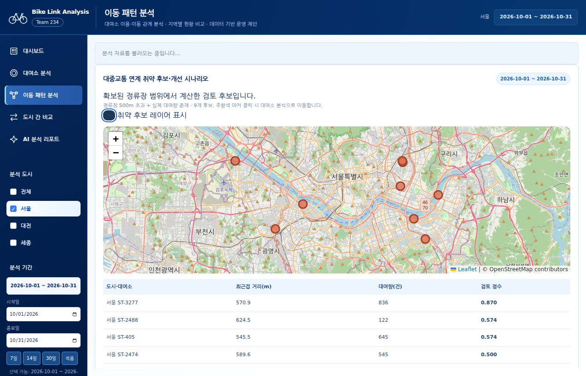
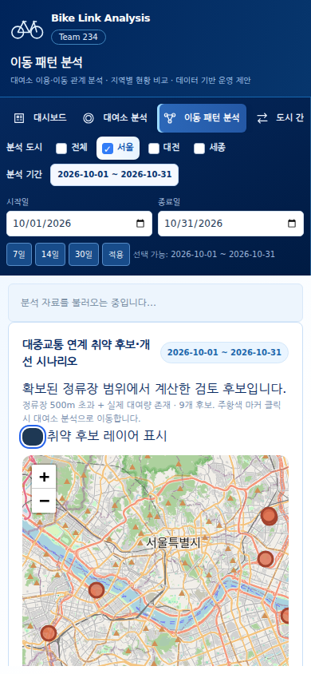
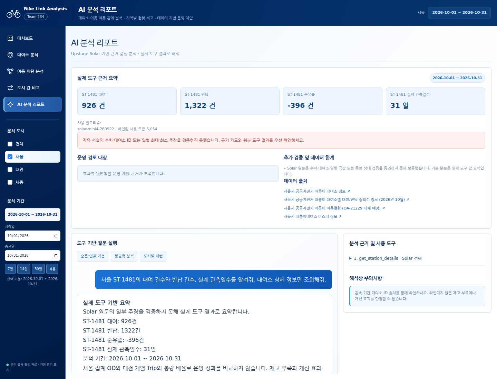
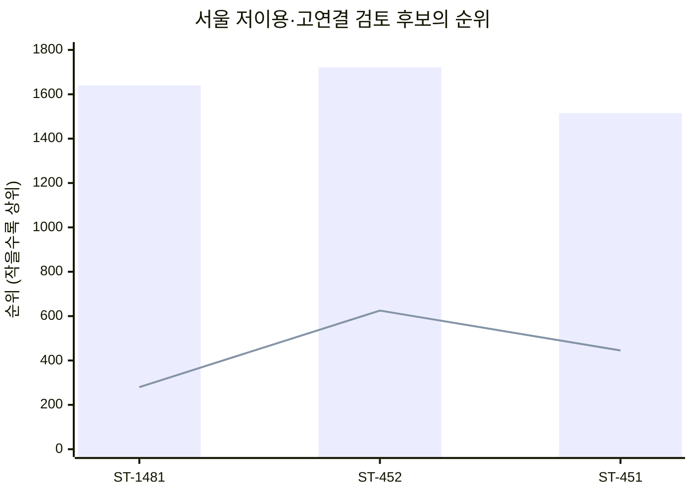
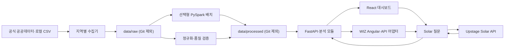

# Bike Link Analysis

**팀 234 · 공공자전거 데이터 기반 도시별 대중교통 연계 취약 구간 탐지 및 개선 효과 검증**

서울·대전·세종의 실제 확보 자료를 사용하는 FastAPI + SQLite 분석 서비스입니다. 현재 사용 화면은 WIZ Angular이고 React 프론트엔드도 유지합니다. 공식 정류장과 대여소의 공간 연계, 실제 이용 수요, OD 네트워크를 근거로 검토 후보를 찾고 Upstage Solar가 도구 결과를 설명합니다. **자료가 없는 지표는 만들지 않으며**, 합성 샘플은 별도 Demo Mode에만 표시합니다.

핵심 연구 질문은 **“대중교통 연계 취약 구간은 어디인가, 자전거 연계가 어떤 개선 효과를 주는가?”**입니다. 현재 검증한 개선 효과는 **직선거리 버퍼에 기반한 접근 커버 영역 시나리오**이며, 실제 환승 증가나 운영 성과의 인과 효과가 아닙니다. 세종은 총량 수준 비교까지만 가능하며 상세 OD·연계 지표를 만들지 않습니다.

## 핵심 연구 흐름과 현재 결과

| 연구 단계 | 실제 입력·분석 | 제공 결과와 제한 |
|---|---|---|
| 대중교통 연계 | 서울 버스11,228개·지하철1~8호선276행, haversine | 대여소별 최근접 거리·수단별300/500m 개수, 역 인접 이동 비중 |
| 취약 구간 탐지 | 확보 정류장500m 밖 AND 선택 기간 실제 대여량>0 | 서울2026년10월 후보9개, 취약 후보 지도·검토 순위 |
| 개선 시나리오 검증 | 정류장500m 합집합 + 그 안 대여소300m 버퍼 | 커버 면적540.162489→541.035186km², 커버 대여소2,753→2,756개 |
| 근거 해석 | 기존 K-means·코사인 유사도·PageRank·불균형 | 이용 특성·네트워크 역할을 보조 근거로 제시. 환승의 직접 증거와 구분 |
| 대용량 재현 | 대전 원본ZIP 8,008,537행, Spark local[*] | 유효7,605,738건. 기존 SQLite·독립 시간 OD와 양방향 차집합0 |
| AI 보고서 | 기존14개 + 연계 취약/순위 도구2개 | 실제 도구 수치·ID·기간·출처 기반 설명, 미검증 자유 서술 보호 |

서울 역 인접 이동2,220,479건/4,245,954건(52.2964%)은 실제 환승률이 아닙니다. 지하철 자료는 전체 수도권 철도망이 아니며, 정류장과 OD의 기준일도 다릅니다. 대전·세종 정류장은 키/공식 파일 미확보로 연계 분석 N/A입니다. 점수의 동등 가중치는 투명한 검토 기준이며 최적 효과 계수가 아닙니다.

[정류장 출처·스키마·산정식](docs/TRANSIT_LINKAGE.md) · [취약도·시나리오·순위](docs/TRANSIT_VULNERABILITY.md) · [Spark 상세 검산](docs/SPARK_TASHU_PIPELINE.md) · [세종 접근 제한](docs/SEJONG_TRANSIT_AVAILABILITY.md)

기존의 “이용량만으로 보이지 않는 연결·불균형·시간대 역할” 질문은 연계 취약 후보를 해석하는 보조 분석으로 유지합니다. [기존 역할 판정 수식](docs/HIDDEN_ROLE_RULES.md)

## 화면 미리보기

현재 WIZ 대중교통 연계 취약도 화면과 Solar 오류 보호 화면입니다. 이미지는 기존 2026-11-12 검증 기록이며, 마지막 Solar 화면은 실제 응답을 최신 보호 함수에 적용한 **재생 검증**입니다.



| 모바일 취약도 화면 | Solar 보호 후 근거 수치 표시 (재생) |
|---|---|
|  |  |

최신 WIZ 화면의 전용 컴포넌트·API 어댑터·지도 스타일은 [WIZ 통합 소스와 설치 조건](integrations/wiz/README.md)에 보관합니다. React는 별도 실행 화면이며 WIZ 전용 화면과 제공 범위가 같지는 않습니다.

### 이전 단계 화면


*서울 Overview의 Stage 3 캡처입니다. 이 캡처는 Stage 4의 공식 대여소 ID 대응 전 화면이므로 현재 좌표 연결 상태와 다를 수 있습니다.*

| 이동 네트워크 | Solar 분석 보고서 |
|---|---|
|  |  |

[대전 Overview](docs/screenshots/stage3/overview-daejeon.png) · [지역 비교](docs/screenshots/stage3/comparison.png) · [자료 현황](docs/screenshots/stage3/data-status.png) · [모바일 화면](docs/screenshots/stage3/overview-mobile.png)

## 주요 기능

| 화면 | 제공 기능 |
|---|---|
| Overview | 관측된 이용량·기간·대여소, 지도, 날짜·시간대 차트, 연결 거점 |
| Station Analysis | 대여소 검색·선택, 군집 유형, 이용 패턴, 유사 대여소 |
| Network Analysis | 실제 OD 방향 그래프·중심성, 대중교통 연계 취약 후보 지도·레이어 토글·개선 검토 순위·커버 시나리오 |
| Region Comparison | 서울·대전 공통 기간 비율 비교, 세종 연간 추세 별도 표시, 지역별 정의·연계 지표 미확보 안내 |
| AI Agent | Solar 도구16개, 취약 후보·개선 검토 근거·출처·기간을 담은 구조화 보고서 |
| Data Status | 데이터셋 상태·품질·미확보 항목 |
| Demo Mode | 실제 분석과 분리한 합성 샘플 |

### 최신 분석 결과와 해석 범위

2026-11-09에 기록한 서울 2026년 10월 분석 결과입니다. 아래 수치는 저장된 [핵심 발견 검증 보고서](docs/STAGE3_VALIDATION_REPORT.md)를 요약하며, 실행 시 선택 기간에 따라 다시 계산됩니다.

| 검증 항목 | 확인된 결과 | 해석 |
|---|---|---|
| 저이용·고연결 후보 | ST-1481: 이용량 1,640위 / PageRank 280위, ST-452: 1,722위 / 625위, ST-451: 1,515위 / 445위 | 엄격 규칙에 따른 운영 검토 후보이며 환승 기능의 직접 증거는 아님 |
| 기존 후보 재검증 | ST-875·ST-504·ST-1166 모두 7·14·30일에서 엄격 후보 규칙 0/3회 충족 | 숨은 연결 거점으로 확정하지 않음 |
| 지속 불균형 | ST-118: 순유출 +1,292건, ST-2264: 순유출 -1,582건 | 두 곳 모두 관측 31일간 같은 방향. 재고 부족·재배치 효과는 판정 불가 |
| 군집 품질 | 30일 Silhouette: 시간대 비율 0.1297, 이용량 규모 0.5441, 결합 특징 0.1239 | 규모만의 높은 분리도를 역할 군집 개선으로 해석하지 않음 |
| 군집 안정성 | 결합 특징 ARI: 7↔14일 0.6794, 14↔30일 0.7164 | 공통 대여소 기준이며 계절 안정성은 검증하지 못함 |

아래 그림은 동일한 서울 관측 기간의 **이용량 순위와 PageRank 순위 차이**를 보여줍니다. 순위 숫자가 작을수록 상위이며 두 값은 건수나 점수가 아닙니다.



막대는 이용량 순위, 선은 PageRank 순위입니다. 그래프가 표시되지 않는 뷰어에서는 위 표에서 같은 수치를 확인할 수 있습니다.

분석 화면은 후보 상세의 TOP 10 입·출 연결, 7·14·30일 민감도, 군집 품질 비교, 일별·시간대별·평일/주말 불균형과 운영 검토 유형을 제공합니다. `순유출 = 대여 - 반납`으로 통일하며, 양수는 순유출·음수는 순유입입니다. Silhouette가 0.2 미만이면 유형 해석을 보류합니다. 매개 중심성은 최대 32개 노드 표본 근사이며, 날씨·재고·재배치 자료 없이 인과관계를 주장하지 않습니다.

### 데이터 처리 구조



분석 모듈은 K-means 군집화, 코사인 유사도, NetworkX 방향 그래프와 중심성을 사용합니다. 네트워크 중심성은 **전체 OD 그래프**에서 계산하며, 화면에는 상위 노드와 간선만 표시합니다. AI 보고서의 구조화 카드·차트는 서버가 도구 결과로 만들고, Solar의 자유 서술은 별도로 보여줍니다. [에이전트 구조와 검증 경계](docs/SOLAR_AGENT_ARCHITECTURE.md)

## 현재 연결된 자료

| 지역 | 확인된 자료 | 분석 범위 |
|---|---|---|
| 서울 따릉이 | 2026-10-01~31 대여소별 OD 시간 집계, 공식 대여소 마스터 | 이용 패턴·군집·유사도·기간별 OD 네트워크·검증된 대여소 좌표 |
| 대전 타슈 | 대여소 목록, 2025-12-01~2026-10-31 실제 대여이력 7,605,738건 | 월·요일·시간대 패턴·군집·유사도·기간별 Trip 기반 OD·지도 |
| 세종 어울링 | 2017~2025 연간 이용 건수 및 2026-08-31 부분 누계 | 연간 총량 |

서울 OD는 **개별 Trip이 아닌 집계**이고 대전은 개별 Trip을 집계합니다. 서울은 연속 31일, 대전은 연속 335일의 대여 관측을 연결했습니다. 기간을 맞추더라도 모집단·운영방식·집계 방식이 다르므로 총량을 단순 비교하면 안 됩니다. 세종은 대여소 단위 이용 기록과 OD를 확보하지 못해 해당 분석을 제공하지 않습니다. 상세 메타데이터 존재와 실제 파일 확보를 구분하며, [신청 절차·기준일 제한](docs/SEJONG_TRANSIT_AVAILABILITY.md)을 공개합니다.

서울 OD ID 2,763개 중 2,762개는 공식 대여소 마스터의 ID와 직접 일치하고 유효 좌표가 확인됐습니다. 미확인 ID `X`는 지도·중심성 시각화에서 제외합니다. 공식 마스터의 **현재 좌표가 관측일에도 같았는지**는 추가 확인이 필요합니다. [ID 대응 검증](docs/SEOUL_STATION_ID_MAPPING.md) · [데이터 출처·라이선스·컬럼](docs/DATA_SOURCES.md) · [공통 데이터 형식](docs/data-contract.md)

## 로컬 실행

Python 3.11+와 Node.js 20+가 필요합니다. 저장소 루트에서:

```bash
python -m venv .venv
.venv/bin/pip install -r backend/requirements.txt
cp .env.example .env
.venv/bin/python -m scripts.collect.collect_all
.venv/bin/python -m scripts.preprocess.normalize
.venv/bin/python -m scripts.preprocess.map_seoul_stations
.venv/bin/python -m scripts.preprocess.validate_stage3
.venv/bin/uvicorn backend.main:app --host 127.0.0.1 --port 8000
```

새 터미널에서:

```bash
cd frontend
npm ci
npm run dev
```

Vite 주소는 보통 `http://localhost:5173`이며 `/api`를 FastAPI로 프록시합니다. `collect_all`은 공식 원본을 내려받으므로 네트워크·디스크 공간이 필요합니다. 서울 마스터 대응 명령은 공식 사이트에 다시 접속합니다. 수집이 어려우면 [출처 문서](docs/DATA_SOURCES.md)의 지역별 수집·로컬 파일 가져오기 방법이나 화면의 정규화 CSV 업로드를 사용하세요. 원본 및 처리 파일은 Git에 포함되지 않으므로 새 환경에서는 수집과 정규화를 다시 해야 합니다. 대전 Trip은 월별로 나누고 API 조회용 집계는 인덱스가 있는 `analysis.sqlite`에 저장해 수백만 CSV 행을 메모리에 한꺼번에 올리지 않습니다.

### API 키와 비밀 정보

`.env.example`을 복사한 **로컬 `.env`에만** 값을 입력합니다. `UPSTAGE_API_KEY`는 Solar 분석에, `DATA_GO_KR_API_KEY`는 공공데이터포털 자동변환 OpenAPI에 사용합니다. 키가 없으면 AI 채팅은 설정 안내를 반환합니다. 키 값은 브라우저로 전송하지 않으며 `.env`와 변형 파일(빈 예시 제외), 개인키, 원본 데이터, 처리 데이터, 빌드 산출물, `data/solar-audit/`의 실행 감사 로그는 `.gitignore`에서 제외합니다. `docs/`의 검증 기록은 공개 가능한 근거 자료로 보관합니다. 실제 키는 코드·README·화면 캡처·검증 응답에 넣지 마세요. `BIKE_DATABASE_URL`은 향후 전용 PostgreSQL 전환을 위한 예시이며 현재는 CSV·JSON과 조회용 SQLite를 사용합니다. 공공데이터포털 OpenAPI는 경로만 확인했고 인증 호출 결과는 아직 검증하지 않았습니다.

## API와 검증

주요 엔드포인트는 `GET /api/health`, `/api/regions`, `/api/regions/{region_id}/{overview|stations|clusters|network|centrality|similarity}`, `/api/compare`, `/api/data-sources`, `/api/data-quality`, `/api/data-validation`입니다. `POST /api/regions/{region_id}/upload`로 정규화 CSV를 가져올 수 있고, `POST /api/agent/chat`은 Solar 보고서를 반환합니다. 운영 분석 API로 `GET /api/regions/{region_id}/{cluster-stability|imbalance|hidden-hubs|role-candidates}`, 대여소 검증 API로 `GET /api/regions/{region_id}/stations/{station_id}/{hidden-hub-validation|role-history}`도 제공합니다. 지역 및 비교 API는 `date_start`, `date_end`를 지원합니다. 합성 샘플 API는 `/api/demo/*`에만 있습니다. FastAPI 실행 후 `http://127.0.0.1:8000/docs`에서 스키마를 확인할 수 있습니다.

```bash
.venv/bin/python -m pytest backend/tests -q
cd frontend && npm run build
```

[Stage 3 화면·검증 기록](docs/DEVELOPMENT_LOG_STAGE3.md) · [Stage 4 Solar 테스트](docs/SOLAR_TOOL_TESTS.md) · [Stage 4 개발 기록](docs/DEVELOPMENT_LOG_STAGE4.md)


### 새 대중교통 연계 API

| 메서드·경로 | 인자 | 결과 |
|---|---|---|
| GET /api/transit-linkage | city, date_start, date_end | 대여소별 거리·수단별300/500m 정류장 수, 시간대 역 인접 이동 비율 |
| GET /api/vulnerability | city, date_start, date_end | 실제 수요가 있는500m 밖 후보, 공간 시나리오·가정·출처 |
| GET /api/improvement-ranking | city, date_start, date_end, top_n(1~20) | 도시 내 검토 점수·구성 값·가중치 민감도 |

city는 seoul/daejeon/sejong입니다. 미확보 도시는 available=false, 지표는 null/N/A이며 0으로 채우지 않습니다. WIZ 전체 선택은 확보 도시 결과를 모아 표시하고 도시 간 동일 점수 척도의 효과 순위로 합치지 않습니다.
Solar 새 도구: get_transit_vulnerability(region_id,date_range), get_improvement_ranking(region_id,top_n,date_range). 화면에서 선택한 도시·기간을 서버가 고정합니다.

### 이번 확장 검증 (2026-11-12)

- 기존 포함 pytest **31 passed**, Spark fixture도 실제 Java/PySpark로 실행.
- python -m compileall -q backend scripts 통과, React tsc/Vite 및 WIZ 빌드 통과.
- 실제 WIZ 취약 후보 지도9개·레이어 토글·대여소 이동, 데스크톱/모바일 검증. 페이지 오류0, 모바일 가로 넘침 없음.
- Solar 실호출1질문: get_transit_vulnerability 선택, ST-3277 거리570.948m·대여836건 인용. 수치41/41·ID 검증 통과,5,633토큰. 자유 서술 의미 전체 검증의 증거는 아님.
- Spark 원본 전체와 기존 SQLite 일별 OD5,350,360행·이용집계4,502,831행이 정확히 일치. 시간 OD6,855,588행은 기존 Trip의 독립 SQLite 집계와 일치.
- [실제 API·검증 JSON·화면 캡처](docs/transit/) 보관. 이후 자동으로 재실행되는 결과가 아니라 이번 실행 기록입니다.

### 최신 Solar 복구와 이번 Git 반영 검증 (2026-11-12)

- 기존 [Solar 복구 기록](docs/SOLAR_RECOVERY_20261112.md)은 최대·최소 설명 오류 차단, 관측일수 검증, 모델 실패 시 도구 수치 보존, 확인된 토큰과 미반환 사용량 구분을 설명합니다.
- 이 Git 반영 작업에서는 현재 실행 환경의 `python -m pytest backend/tests -q`로 **46 passed, 2 warnings**를 확인했습니다. 선택형 Spark fixture도 포함됐습니다. React의 `npm run build`도 통과했습니다.
- 위의 과거 브라우저·Solar 실호출·전체 Spark 데이터 검산 기록과 이번 테스트 실행을 구분합니다. 이번 Git 반영에서 유료 Solar 호출, 전체 원본 Spark 재집계, WIZ 서비스 배포는 수행하지 않았습니다.

## 저장소 구성과 재현 시 주의사항

| 경로 | 역할 |
|---|---|
| `backend/analysis/` | 군집화·유사도·네트워크 중심성 |
| `backend/services/` | 정규화 데이터 조회·SQLite 집계·업로드 검증 |
| `backend/agents/` | Solar 도구 실행·구조화 보고서·응답 수치 대조 |
| `frontend/src/` | 대시보드·지도·차트·운영 분석 화면 |
| `scripts/collect/`, `scripts/preprocess/` | 공식 자료 수집·정규화·대여소 ID 대응 |
| `backend/tests/fixtures/` | 자동 테스트용 소규모 자료 |
| `docs/` | 데이터 계약·출처·분석 신뢰도·검증 기록과 화면 캡처 |
| `integrations/wiz/` | 현재 WIZ 전용 화면·API 어댑터·Leaflet 스타일과 통합 조건 |

화면 이미지는 캡처 시점의 기록입니다. 새로 실행한 화면이나 최신 테스트 통과를 뜻하지 않습니다. 위 연구 결과도 저장된 분석 기록이며 자동 테스트는 소규모 fixture를 사용합니다. Solar 실호출은 유료 API 사용량이 발생할 수 있습니다.

서울 OD 출처 변경에 관한 기존 조사와 대체 자료의 제약은 [데이터 전환 기록](docs/SEOUL_DATASET_TRANSITION.md)을 확인하세요. 서울 전체 일별 총량 자료는 대여소별 OD를 대체할 수 없으므로, 수집 불가 시 이전 원본 보관본이나 같은 스키마의 정규화 자료가 필요합니다.

## 선택형 PySpark 대전 배치

기존 FastAPI 서비스 실행에는 Spark가 필요하지 않습니다. 배치 작업에서만 아래 환경을 준비합니다.
```bash
# Java 17 이상 설치 후 실제 설치 경로를 지정
export JAVA_HOME=/usr/lib/jvm/java-17-openjdk-amd64
python -m pip install -r backend/requirements-spark.txt
python -m scripts.preprocess.spark_tashu --raw-zip data/raw/15137219.zip --output data/processed/spark-tashu-20261112
python -m scripts.validate.spark_tashu --output data/processed/spark-tashu-20261112 --reference data/processed/analysis.sqlite --reference-trips data/processed/trips --report docs/transit/spark-validation.json
python -m pytest backend/tests/test_spark_pipeline.py -q
```
정규화된 유효 Trip을 재집계할 때는 `--raw-zip` 대신 `--input 'data/processed/trips/*.csv'`를 사용합니다. 모든 산출물은 새 디렉토리에 저장하며 기존 SQLite를 교체하지 않습니다. 재실행은 새 `--output` 및 `--report` 경로를 사용하세요.
기본 master는 local[*]입니다. 컨테이너 메모리 8GB에서 과도한 JVM 스레드를 막기 위해 ActiveProcessorCount=4, driver heap 2GB, shuffle 32로 설정했습니다. Spark SQL만 사용하며 Python UDF로 전체 기록을 메모리에 모으지 않습니다. 자세한 입력·출력·검증 범위는 [Spark 배치 문서](docs/SPARK_TASHU_PIPELINE.md)를 참조하세요.
