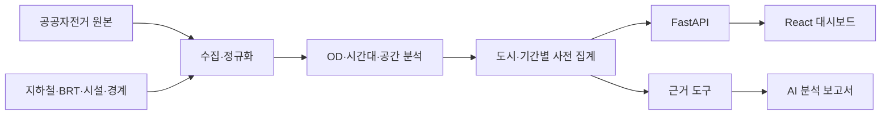
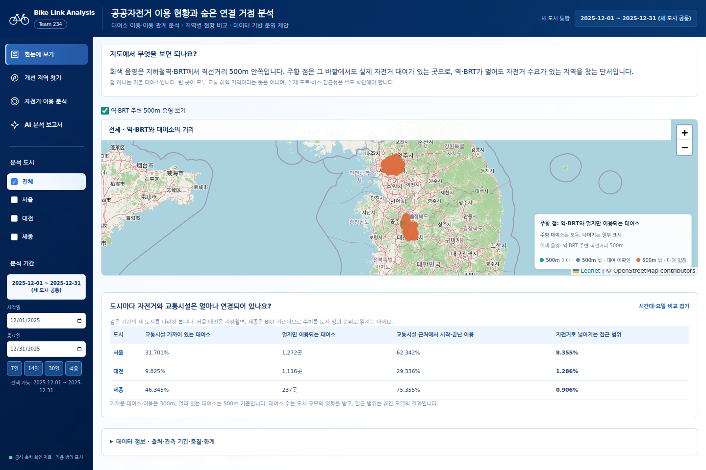
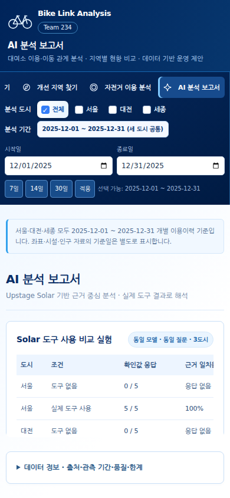

# Bike Link Analysis

서울·대전·세종 공공자전거의 이용 흐름과 대중교통 연결 공백을 분석해 신규 설치·운영 재배치 검토 근거를 제공하는 데이터 분석 서비스입니다.

> 팀 234 · 빅데이터개론 프로젝트
> 기준 분석 기간: 2025-12-01 ~ 2025-12-31

## 만든 이유와 목표

공공자전거 운영 데이터에는 단순 대여량 순위만으로 설명하기 어려운 문제가 있습니다. 이용량은 많지만 대중교통과 멀리 떨어진 대여소, 전체 이동망에서 연결 역할이 큰 대여소, 시간대별 유출입이 불균형한 대여소는 서로 다른 기준으로 살펴봐야 합니다.

이 프로젝트는 다음 질문에 실제 데이터로 답하는 것을 목표로 합니다.

- 자전거 이동이 지하철역·BRT 정류장과 얼마나 연결되어 있는가?
- 대중교통 접근이 취약하지만 실제 이용 수요가 있는 곳은 어디인가?
- 신규 대여소 후보를 선택하면 접근 공백 면적이 얼마나 줄어드는가?
- 이용량, PageRank, 매개 중심성, K-means가 각각 어떤 운영 관점을 보여 주는가?
- 분석 결과와 한계를 AI가 근거와 함께 설명할 수 있는가?

프로젝트를 통해 대용량 공공데이터 수집·정규화, OD 네트워크 분석, 공간 연산, 군집화, 사전 집계 기반 API, 데이터 근거형 AI 보고서, React 시각화까지 하나의 재현 가능한 흐름으로 연결했습니다.

## 주요 기능

1. **한눈에 보기**
   - 도시별 대여량, 대여소 수, 대중교통 연결 지표를 요약합니다.
   - 서울·대전·세종과 전체 도시를 같은 2025년 12월 기준으로 비교합니다.

2. **개선 지역 찾기**
   - 대중교통 앵커 500m 밖에 있으면서 실제 이용량이 있는 취약 대여소를 찾습니다.
   - 기존 대여소 300m 밖 격자에서 신규 설치 후보를 만들고 접근 공백·주변 수요·시설 정보를 함께 평가합니다.
   - 후보 선택 시 300m 버퍼 합집합을 이용해 추가 커버 면적을 계산합니다.

3. **자전거 이용 분석**
   - 대여소별 수요, 시간대 패턴, K-means 군집, Cosine 유사도, OD 연결을 분석합니다.
   - PageRank·가중 연결도·매개 중심성을 함께 보여 주어 단순 이용량과 네트워크 역할을 구분합니다.
   - 시간대 대여·반납 순유출입으로 운영 재배치 검토 지점을 제시합니다.

4. **AI 분석 보고서**
   - 화면에서 선택한 도시·기간·대여소·후보를 분석 도구의 실제 결과와 함께 전달합니다.
   - 수치와 대여소 ID를 검증하고, 검증되지 않은 자유 서술은 근거 요약과 구분합니다.
   - API 키가 없을 때는 일반 분석 화면만 사용할 수 있습니다.

## 사용한 기술

| 영역 | 기술 | 역할 |
|---|---|---|
| 언어 | Python 3.11+, TypeScript | 분석·API·검증 및 프론트엔드 구현 |
| 백엔드 | FastAPI, Uvicorn, Pydantic | REST API, 입력 검증, 분석 결과 제공 |
| 프론트엔드 | React 19, Vite, Tailwind CSS | 분석 대시보드와 반응형 UI |
| 지도·차트 | Leaflet, React Leaflet, Recharts | 대여소·앵커·후보 지도와 지표 시각화 |
| 데이터 처리 | pandas, openpyxl | CSV·XLSX 정규화와 집계 |
| 분석 | NetworkX, scikit-learn | PageRank·중심성·K-means·Cosine 분석 |
| 공간 분석 | Shapely, pyproj | 거리·버퍼·중복 제거·면적 계산 |
| 대용량 처리 | PySpark(선택) | 대용량 대전 원본 정규화 파이프라인 |
| 저장 | SQLite, JSON/CSV | 정규화 데이터, 사전 집계, 검증 근거 |
| AI | Upstage Solar, OpenAI 호환 SDK | 도구 호출 기반 분석 설명 생성 |
| 품질 | pytest, TypeScript, Vite build | 회귀 테스트와 프로덕션 빌드 검증 |

## 데이터 범위와 현재 결과

세 도시 모두 같은 31일의 개별 이용이력을 사용합니다. 도시 식별자를 분리해 전체 그래프에서 ID 충돌과 도시 간 가상 이동을 막았습니다.

| 도시 | 유효 이용이력 | 관측 대여소 ID | 대중교통 앵커 |
|---|---:|---:|---|
| 서울 따릉이 | 1,954,344건 | 2,778개 | 지하철역 |
| 대전 타슈 | 368,491건 | 1,374개 | 지하철역 |
| 세종 어울링 | 164,366건 | 727개 | BRT 정류장 |
| 합계 | **2,487,201건** | 도시별 ID 분리 | 도시 간 간선 없음 |

| 도시 | 앵커 300m 내 대여소 | 앵커 500m 밖 이용 대여소 | 앵커 연계 OD 비중 |
|---|---:|---:|---:|
| 서울 | 31.701% | 1,272개 | 62.342% |
| 대전 | 9.825% | 1,116개 | 29.336% |
| 세종 | 46.345% | 237개 | 75.355% |

연계 OD는 출발·도착 중 한쪽 이상이 앵커 300m 안에 있는 이동을 뜻하며, 실제 환승률을 의미하지 않습니다. 자세한 검산은 [공통 기간 검증 결과](docs/common-december-validation-20261118.json)에서 확인할 수 있습니다.

## 분석 구조



요청 시마다 무거운 공간 분석을 다시 수행하지 않습니다. 수집·정규화·집계 단계에서 결과와 입력 해시를 만들고, API는 준비된 결과만 조회합니다. 입력 내용이나 기간이 다르면 기존 결과로 대체하지 않고 준비 오류를 반환합니다.

## 실행 화면

### 전체 도시 한눈에 보기


같은 2025년 12월 기준으로 세 도시의 핵심 지표와 대중교통 연결 현황을 한 화면에서 비교합니다.

### 도시별 비교



도시 규모가 다른 점을 고려해 총량뿐 아니라 비율, 연결 범위, 후보 근거를 함께 읽도록 구성했습니다.

### 모바일 화면



작은 화면에서도 지도·지표·후보를 순서대로 확인할 수 있도록 반응형 레이아웃을 적용했습니다.

## 실행 방법

### 1. 요구 사항

- Python 3.11 이상
- Node.js 20 이상과 npm
- Git
- 원본을 다시 처리하려면 각 공공데이터 파일과 충분한 디스크 공간
- AI 보고서를 사용하려면 Upstage API 키

### 2. 저장소 받기

```bash
git clone https://github.com/xericen/bike-link-analysis.git
cd bike-link-analysis
```

### 3. 백엔드 설치

```bash
python -m venv .venv
source .venv/bin/activate
python -m pip install --upgrade pip
python -m pip install -r backend/requirements.txt
```

Windows PowerShell에서는 다음 명령으로 가상환경을 활성화합니다.

```powershell
.venv\Scripts\Activate.ps1
```

### 4. 환경변수 설정

```bash
cp .env.example .env
```

`.env`에는 필요한 값만 직접 입력합니다. 실제 키는 Git에 커밋하지 않습니다.

```dotenv
UPSTAGE_API_KEY=
UPSTAGE_MODEL=solar-mini4
DATA_GO_KR_API_KEY=
```

### 5. 데이터 준비

공개 원본 대용량 파일과 생성 데이터베이스는 저장소에 포함하지 않습니다. 원본을 확보한 뒤 다음 순서로 실행합니다.

```bash
export PYTHONPATH=.
export OPENBLAS_NUM_THREADS=1
export OMP_NUM_THREADS=1

python scripts/collect/collect_common_december.py
python scripts/preprocess/common_december.py
python scripts/preprocess/common_december.py --activate
python scripts/preprocess/precompute_city_kpis.py \
  --workers 2 \
  --report docs/transit/common-december-kpis-20261118.json
python scripts/validate/common_december_validation.py
python scripts/validate/anchor_presentation_audit.py
python scripts/validate/decision_inputs.py
python scripts/collect/audit_candidate_routes.py
python scripts/deploy/release.py --verify-only
```

정규화 결과를 활성화하기 전에 스테이징 검증을 완료해야 합니다. 기존 처리 데이터가 있으면 스크립트가 무조건 덮어쓰지 않으며, 기간별 보관 경로를 사용합니다.

### 6. 백엔드 실행

```bash
uvicorn backend.main:app --reload --host 127.0.0.1 --port 8000
```

정상 여부는 다음 주소에서 확인합니다.

```bash
curl http://127.0.0.1:8000/api/health
curl http://127.0.0.1:8000/api/readiness
```

### 7. 프론트엔드 실행

새 터미널에서 실행합니다.

```bash
cd frontend
npm ci
npm run dev
```

브라우저에서 `http://127.0.0.1:5173`을 엽니다. 개발 서버는 `/api` 요청을 `127.0.0.1:8000`으로 전달합니다.

### 8. 사용 순서

1. 상단에서 서울·대전·세종 또는 전체 도시를 선택합니다.
2. **한눈에 보기**에서 데이터 범위와 연결 지표를 확인합니다.
3. **개선 지역 찾기**에서 기존 취약·신규 설치·재배치 검토 탭을 비교합니다.
4. 후보를 선택해 추가 커버 면적과 중복 제거 결과를 확인합니다.
5. **자전거 이용 분석**에서 대여소 수요, 군집, OD, PageRank와 불균형을 확인합니다.
6. API 키가 설정된 경우 **AI 분석 보고서**에서 현재 선택 맥락을 질문합니다.

## 테스트와 빌드

```bash
export PYTHONPATH=.
export OPENBLAS_NUM_THREADS=1
export OMP_NUM_THREADS=1

python -m pytest backend/tests -q
python -m compileall -q backend scripts

cd frontend
npm ci
npm run build
```

배포 전 준비 상태만 검사하려면 다음 명령을 사용합니다.

```bash
python scripts/deploy/release.py --verify-only
```

배포된 FastAPI 서버의 사전 집계 상태까지 확인하려면 다음과 같이 실행합니다.

```bash
python scripts/deploy/release.py --verify-only --check-url https://example.com
```

## 보안 원칙

- `.env`, 개인키, 토큰, 원본 대용량 데이터, 처리 DB, AI 감사 로그는 Git에서 제외합니다.
- 공개 가능한 기본값만 `.env.example`에 둡니다.
- API 키는 서버 환경변수로만 읽으며 프론트엔드 번들에 넣지 않습니다.
- 업로드 파일은 종류·도시·필수 컬럼을 검증한 뒤 처리합니다.
- AI 답변은 도구 근거·수치·대여소 ID 검사를 거치며 원문 전체를 사실로 간주하지 않습니다.

## 디렉터리 구조

```text
backend/                 FastAPI, 분석 로직, AI 에이전트, 테스트
frontend/                React 대시보드
scripts/collect/         공공데이터 수집과 출처 점검
scripts/preprocess/      정규화와 사전 집계
scripts/validate/        수치·문서·분석 결과 검증
scripts/deploy/          배포 전 준비 상태 검사
data/samples/            공개 가능한 소형 예제
docs/                    분석 기준, 검증 결과, 실행 화면
notebooks/               탐색 분석용 노트북 위치
빅데/                    수업 보고서와 공개 참고 자료
```

## 배운 점

- **같은 기간이 먼저입니다.** 도시별 기간이 다르면 총량과 패턴 비교가 왜곡되므로 2025년 12월 공통 기간을 별도로 구축했습니다.
- **ID를 추측해 합치면 안 됩니다.** 이름이나 숫자 모양만으로 대여소를 연결하지 않고 공식 매핑과 원본 ID를 보존했습니다.
- **지표는 서로 다른 질문에 답합니다.** 이용량, PageRank, 매개 중심성, 군집은 같은 ‘중요도’가 아니므로 화면과 설명에서 역할을 분리했습니다.
- **공간 후보는 예측이 아닙니다.** 접근 공백과 주변 관측 수요는 검토 우선순위이며 설치 후 수요·환승 증가를 보장하지 않습니다.
- **사전 집계에는 버전 검증이 필요합니다.** 빠른 응답만큼 입력 해시·기간·도시 조합이 일치하는지 확인하는 절차가 중요했습니다.
- **AI 설명도 검증 대상입니다.** 모델 답변을 그대로 표시하지 않고 실제 도구 호출, 수치 토큰, ID와 출처를 함께 확인했습니다.

## 한계

- 2025년 12월 한 달은 겨울 관측이므로 계절·장기 추세로 일반화할 수 없습니다.
- 위치·BRT·시설·인구·행정 경계 자료의 기준 시점과 공간 해상도가 서로 다릅니다.
- 직선거리와 현재 도로망은 실제 보행 동선, 경사, 장벽, 공사 상황을 완전히 반영하지 않습니다.
- 재고, 운영 이동, 설치 허가, 보도 폭, 예산 자료가 없어 실제 재배치 수량이나 설치 효과를 확정하지 않습니다.
- 낮은 Silhouette 값 때문에 K-means 군집 번호를 고정된 대여소 역할로 단정하지 않습니다.
- AI 보고서는 근거 확인을 돕는 보조 기능이며 현장 조사와 운영 의사결정을 대체하지 않습니다.

## 데이터 출처

- [서울 열린데이터광장 공공자전거 대여이력](https://data.seoul.go.kr/dataList/OA-15182/F/1/datasetView.do)
- [공공데이터포털 대전 타슈 대여이력](https://www.data.go.kr/data/15137219/fileData.do)
- [공공데이터포털 세종 어울링 이용이력](https://www.data.go.kr/data/15106191/fileData.do)
- [상세 데이터 기준과 한계](docs/FINAL_DATA_SOURCES.md)
- [분석 수식](docs/FINAL_ANALYSIS_FORMULAS.md)
- [사전 집계 운영 절차](docs/PRECOMPUTED_KPIS.md)

`docs/`의 날짜별 보고서와 화면은 당시 검증 기록입니다. 현재 서비스 수치와 기간은 2025년 12월 공통 기간 결과를 기준으로 확인합니다.
