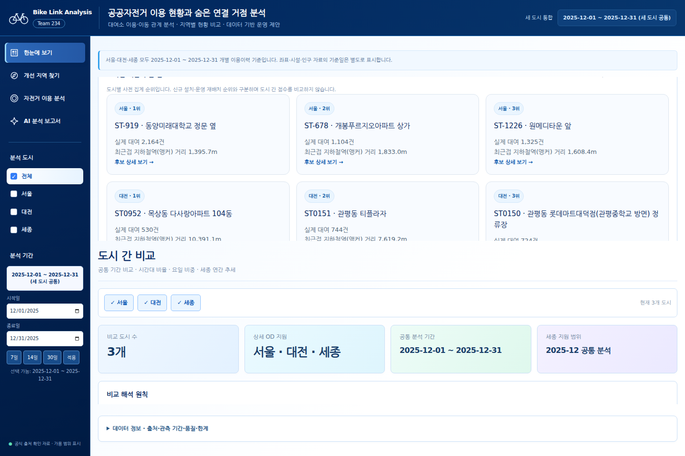
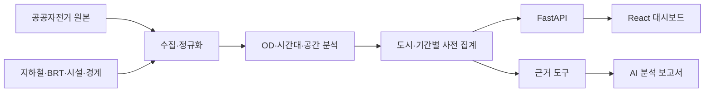

# Bike Link Analysis

**[서비스 바로가기](https://project.wizide.com/course/aafa5691f92f40e89818200a14c98a90?public=1)** · [분석 문서](#10-문서-맵) · 팀 234 · 빅데이터개론

**기준 서비스 기간: 2025-12-01 ~ 2025-12-31** — 전체 도시의 공통 비교 기준입니다.

> 기존 5·6·7·8번 보고서는 서울 2026년 10월 사례입니다. 이후 서울·대전 2026-10 / 세종 2025-10 심화 기록과 도시별 보유 전체기간 분석은 별도 범위입니다. 현재 공개 서비스의 개별 도시는 서울 2025년, 대전 2024-08~2026-10, 세종 2020~2025년 자료를 사용하며, 모든 분석을 상단 기간 필터로 임의 전환할 수 있다는 의미는 아닙니다. 아래 최종 후보·시간 검증은 **공통 10개월**로 따로 표시합니다. [기간 안내](docs/REPORT_PERIODS.md) · [최신 범위 기록](docs/README_RELIABILITY.md#조회-범위)

## 1. 한 줄 요약

**248만 건의 3개 도시 공통 기간 이용이력으로 대중교통 연결 공백을 찾고, 신규 설치·운영 재배치 검토 후보를 근거와 함께 제시하는 분석 서비스입니다.**

## 2. 핵심 결과 30초 보기

### 공통 2025년 12월 핵심 지표

| 도시 | 이용 건수 | 앵커 300m 내 대여소 비율 | 연계 OD 비중 | 앵커 500m 밖 이용 대여소 | 근거 |
|---|---:|---:|---:|---:|---|
| 서울 | 1,954,344건 | 31.701% | 62.342% | 1,272곳 | [기록](docs/common-december-validation-20261118.json) |
| 대전 | 368,491건 | 9.825% | 29.336% | 1,116곳 | [기록](docs/common-december-validation-20261118.json) |
| 세종 | 164,366건 | 46.345% | 75.355% | 237곳 | [기록](docs/common-december-validation-20261118.json) |
| 합계 | **2,487,201건** | 도시별 산출 | 도시별 산출 | 2,625곳 | [기록](docs/common-december-validation-20261118.json) |

앵커는 서울·대전의 지하철역, 세종의 BRT 거점입니다. 300m 비율은 위치가 확인된 대여소 기준이며, 연계 OD는 출발·도착 중 한쪽 이상이 앵커 300m 안인 이동입니다. **실제 환승률이 아닙니다.**

### 도시별 최종 검토 후보 3곳 — 공통 10개월 별도 분석

**이 표는 위의 12월 지표와 달리 2025년 1월·4~12월 수요로 선정한 신규 입지 후보입니다.** “최종”은 분석상 검토 목록이며 설치 확정이 아닙니다. 재배치는 재고 자료가 없어 실제 이동 대수 대신 운영 점검 대상으로 제시합니다.

| 도시·순위 | 후보 ID · 지역 | 주변 1km 관측 대여 / 월별 TOP10 | 앵커 · 도보→연계 모델 시간 | 검토 판단·근거 |
|---|---|---:|---|---|
| 서울 1 | `grid-961000-1952500` · 동대문구 | 205,505건 / 10/10개월 | 답십리 · 20.7 → 12.3분 | 현장 검토 · [근거](docs/README_EVIDENCE_20261123.json) |
| 서울 2 | `grid-961500-1952500` · 동대문구 | 197,098건 / 10/10개월 | 장한평 · 28.1 → 12.2분 | 현장 검토 · [근거](docs/README_EVIDENCE_20261123.json) |
| 서울 3 | `grid-942000-1946000` · 양천구 | 152,076건 / 10/10개월 | 신정네거리 · 18.3 → 16.5분 | 현장 검토 · [근거](docs/README_EVIDENCE_20261123.json) |
| 대전 1 | `grid-987000-1811500` · 서구 | 91,833건 / 10/10개월 | 용문 · — | 보류 · [근거](docs/README_EVIDENCE_20261123.json) |
| 대전 2 | `grid-987500-1816500` · 서구 | 112,349건 / 10/10개월 | 갑천 · 22.7 → 26.6분 | 우선도 재검토 · [근거](docs/README_EVIDENCE_20261123.json) |
| 대전 3 | `grid-986500-1811000` · 서구 | 71,573건 / 10/10개월 | 용문 · 93.8 → 23.5분 | 현장 검토 · [근거](docs/README_EVIDENCE_20261123.json) |
| 세종 1 | `grid-981000-1830000` · 세종시 | 95,988건 / 10/10개월 | 시청,시의회,교육청,세무서 · — | 보류 · [근거](docs/README_EVIDENCE_20261123.json) |
| 세종 2 | `grid-980000-1832500` · 세종시 | 43,320건 / 10/10개월 | 전통문화체험관 · 32.3 → 11.3분 | 현장 검토 · [근거](docs/README_EVIDENCE_20261123.json) |
| 세종 3 | `grid-982000-1844000` · 세종시 | 13,875건 / 10/10개월 | 오송역종점 · — | 보류 · [근거](docs/README_EVIDENCE_20261123.json) |

주변 수요는 기존 대여소 관측량으로 후보 간 중복될 수 있습니다. 모델 시간은 현재 도로망의 자전거+도보+대여·반납 2분 가정이며 실측 시간이 아닙니다. **경로 연결 6/9곳, 도보보다 모델 시간이 짧은 후보 5/9곳**입니다. 부지·안전·용량·설치 효과는 현장 확인이 필요합니다. [통합 근거·면적·분모](docs/README_EVIDENCE_20261123.json)

**신뢰성 검증 3축:** [파라미터 강건성](#51-파라미터-강건성--설정을-바꿔도-같은-후보인가) · [시간 강건성](#52-시간-강건성--한-달을-넘어-반복되는가) · [마스킹 재발견](#53-방법-검증--숨긴-대여소를-다시-찾는가)

## 3. 주요 기능과 실행 화면

1. **한눈에 보기**
   - 도시별 대여량, 대여소 수, 대중교통 연결 지표를 요약합니다.
   - 서울·대전·세종과 전체 도시를 같은 2025년 12월 기준으로 비교합니다.

2. **개선 지역 찾기**
   - 대중교통 앵커 500m 밖에 있으면서 실제 이용량이 있는 취약 대여소를 찾습니다.
   - 기존 대여소 300m 밖 격자에서 신규 설치 후보를 만들고 접근 공백·주변 수요·시설 정보를 함께 평가합니다.
   - 후보 선택 시 300m 버퍼 합집합을 이용해 추가 커버 면적을 계산합니다.

3. **자전거 이용 분석**
   - 대여소별 수요, 시간대 패턴, K-means 군집, Cosine 유사도, OD 연결을 분석합니다.
   - PageRank·가중 연결도·매개 중심성을 함께 보여 주어 단순 이용량과 네트워크 역할을 구분합니다.
   - 시간대 대여·반납 순유출입으로 운영 재배치 검토 지점을 제시합니다.

4. **AI 분석 보고서**
   - 화면에서 선택한 도시·기간·대여소·후보를 분석 도구의 실제 결과와 함께 전달합니다.
   - 수치와 대여소 ID를 검증하고, 검증되지 않은 자유 서술은 근거 요약과 구분합니다.
   - API 키가 없을 때는 일반 분석 화면만 사용할 수 있습니다.

5. **분석 결론과 추가 검증**
   - 공통 10개월·개별 전체기간의 최종 후보, 현재 도로망 연결과 시간 가정을 구분합니다.
   - 원본 Spark 처리 대조, Solar 오류 보류, 서울 환승 시간표 모델·개설 관측과 미완료 사유를 표로 보여 줍니다.
   - 자료가 없는 항목을 실제 설치 효과나 현장 검증 완료로 표시하지 않습니다.

### 실제 실행 화면

### 전체 도시 한눈에 보기



같은 2025년 12월 기준으로 세 도시의 핵심 지표와 대중교통 연결 현황을 한 화면에서 비교합니다.

### 도시별 비교


도시 규모가 다른 점을 고려해 총량뿐 아니라 비율, 연결 범위, 후보 근거를 함께 읽도록 구성했습니다.

이미지는 2026-11-18 실행 기록이며, 위의 마크다운 표가 인용 가능한 수치 요약입니다. 이후 공개 서비스의 추가 분석 결론 화면은 별도 범위로 제공됩니다.

### 사용한 기술

| 영역 | 기술 | 역할 |
|---|---|---|
| 언어 | Python 3.11+, TypeScript | 분석·API·검증 및 프론트엔드 구현 |
| 백엔드 | FastAPI, Uvicorn, Pydantic | REST API, 입력 검증, 분석 결과 제공 |
| 프론트엔드 | React 19, Vite, Tailwind CSS | 분석 대시보드와 반응형 UI |
| 지도·차트 | Leaflet, React Leaflet, Recharts | 대여소·앵커·후보 지도와 지표 시각화 |
| 데이터 처리 | pandas, openpyxl | CSV·XLSX 정규화와 집계 |
| 분석 | NetworkX, scikit-learn | PageRank·중심성·K-means·Cosine 분석 |
| 공간 분석 | Shapely, pyproj | 거리·버퍼·중복 제거·면적 계산 |
| 대용량 처리 | PySpark(선택) | 대용량 대전 원본 정규화 파이프라인 |
| 저장 | SQLite, JSON/CSV | 정규화 데이터, 사전 집계, 검증 근거 |
| AI | Upstage Solar, OpenAI 호환 SDK | 도구 호출 기반 분석 설명 생성 |
| 품질 | pytest, TypeScript, Vite build | 회귀 테스트와 프로덕션 빌드 검증 |

## 4. 분석 방법 — 지표마다 다른 질문

공공자전거 운영 데이터에는 단순 대여량 순위만으로 설명하기 어려운 문제가 있습니다. 이용량은 많지만 대중교통과 멀리 떨어진 대여소, 전체 이동망에서 연결 역할이 큰 대여소, 시간대별 유출입이 불균형한 대여소는 서로 다른 기준으로 살펴봐야 합니다.

이 프로젝트는 다음 질문에 실제 데이터로 답하는 것을 목표로 합니다.

- 자전거 이동이 지하철역·BRT 정류장과 얼마나 연결되어 있는가?
- 대중교통 접근이 취약하지만 실제 이용 수요가 있는 곳은 어디인가?
- 신규 대여소 후보를 선택하면 접근 공백 면적이 얼마나 줄어드는가?
- 이용량, PageRank, 매개 중심성, K-means가 각각 어떤 운영 관점을 보여 주는가?
- 분석 결과와 한계를 AI가 근거와 함께 설명할 수 있는가?

프로젝트를 통해 대용량 공공데이터 수집·정규화, OD 네트워크 분석, 공간 연산, 군집화, 사전 집계 기반 API, 데이터 근거형 AI 보고서, React 시각화까지 하나의 재현 가능한 흐름으로 연결했습니다.

| 지표·방법 | 답하는 질문 | 해석 주의 |
|---|---|---|
| 이용량 | 어디서 얼마나 빌리고 반납하는가? | 도시·기간·대여소 규모를 먼저 구분 |
| PageRank | 연결된 이동망에서 어떤 대여소가 중요한가? | 이용량 순위·설치 효과와 다름 |
| 가중 연결도·매개 중심성 | 연결 규모와 경유 역할은 어떤가? | 그래프 구성과 가중치 정의에 영향 |
| K-means·Cosine | 이용 패턴이 어떻게 비슷하거나 다른가? | 군집 번호를 고정 역할로 단정하지 않음 |
| 공간 후보 점수·버퍼 합집합 | 접근 공백을 어디서 보완할 수 있는가? | 신규 수요·실제 환승 효과 예측이 아님 |
| 마스킹·민감도·월별 반복성 | 후보 선정 근거가 조건에 얼마나 견디는가? | 관측 위치 재발견과 미래 설치 성과를 구분 |


## 5. 신뢰성 검증

### 5.1 파라미터 강건성 — 설정을 바꿔도 같은 후보인가?

기준은 앵커 반경 500m·격자 500m·균등 가중치입니다. 숫자는 기준 TOP10과의 지리적 겹침 비율이며, 같은 격자에서는 동일 위치를 비교합니다.

| 도시 | 앵커 300 / 500 / 800m | 수요 우선 / 공백 우선 가중치 | 격자 250 / 750m |
|---|---:|---:|---:|
| 서울 | 60% / 100% / 70% | 60% / 90% | 40% / 0% |
| 대전 | 90% / 100% / 80% | 90% / 100% | 30% / 10% |
| 세종 | 90% / 100% / 100% | 40% / 100% | 10% / 40% |

격자가 달라질 때는 300m 이내 일대일 대응을 사용합니다. 특히 격자 변경에 민감하므로 “모든 조건에서 안정적”이라고 결론내리지 않습니다. [조건·가중치·순위 이동 기록](docs/README_EVIDENCE_20261123.json) · [해석](docs/README_RELIABILITY.md#파라미터-강건성)

### 5.2 시간 강건성 — 한 달을 넘어 반복되는가?

세 도시 모두 날짜가 완전한 **2025년 1월·4~12월, 10개월·306일**을 비교했습니다. 불완전한 2·3월을 0으로 채우지 않았으며 연간 전체 결과가 아닙니다.

| 도시 | 공통 10개월 이용 | 하루 평균 | 앵커 근접 OD 비중 | 후보 모델 연결 / 도보보다 짧은 후보 |
|---|---:|---:|---:|---:|
| 서울 | 32,693,864건 | 106,842.7건 | 61.552% | 3/3 · 3/3 |
| 대전 | 5,107,326건 | 16,690.6건 | 27.129% | 2/3 · 1/3 |
| 세종 | 2,333,498건 | 7,625.8건 | 73.868% | 1/3 · 1/3 |

도시별 최종 3곳은 공통 10개월 동안 모두 TOP10에 10/10회 재등장했습니다. 고정 공간 참조와 같은 관측자료에서 확인한 **사후 반복성**이며, 미래 수요 예측이나 설치 효과 검증은 아닙니다. [월·분모·후보 기록](docs/README_EVIDENCE_20261123.json) · [해석](docs/README_RELIABILITY.md#시간-강건성)

### 5.3 방법 검증 — 숨긴 대여소를 다시 찾는가?

12월 인기 대여소 마스킹에서 기존 종합 점수는 세 도시 모두 **0/10**을 재발견했습니다. 이 실패를 보존하고, 별도 6월 자료로 방법을 고른 뒤 잠금하여 7월 자료에서 평가했습니다. 아래는 7월의 **공백 지역 고이용 대여소 10곳** 평가입니다.

| 도시 | 선택 방법 Recall@10 | 복구된 쌍의 평균 거리 | 기존 점수 / 수요만 복구@10 | 무작위 평균 Recall@10 |
|---|---:|---:|---:|---:|
| 서울 | 2/10 (20%) | 155.7m | 3/10 · 2/10 | 0.67% |
| 대전 | 1/10 (10%) | 25.3m | 0/10 · 1/10 | 0.67% |
| 세종 | 1/10 (10%) | 160.3m | 1/10 · 0/10 | 2.00% |

복구 반경은 300m, 매칭은 일대일입니다. 거리는 **복구된 쌍에 한정**하며 전체 목표의 평균 오차가 아닙니다. 서울은 기존 점수보다 낮았고 대전은 수요만 기준과 같았습니다. 무작위·공간 블록 평가까지 일관되게 우수하지 않아 운영 추천을 교체하지 않았습니다. [전체 fold·베이스라인·실패 단계](docs/README_EVIDENCE_20261123.json) · [해석](docs/README_RELIABILITY.md#방법-검증)

아직 미완료인 검증은 실제 설치 후 이용 변화, 실측 환승·통행시간, 과거 위치 동일성, 재고·거치 용량입니다. 검증되지 않은 항목을 완료 수치로 채우지 않습니다.

### 추가 검증의 현재 도달 범위

| 항목 | 확인된 결과 | 남은 한계·기록 |
|---|---|---|
| 원본 Spark 대조 | CSV 63개·유효 이용 65,072,555건, 3도시의 3종 집계가 기존 DB와 일치 | 도시별 기간이 다른 처리량이며 공통 기간 이용량과 다름. [기록](docs/COMPLETION_AUDIT_20261123.md) |
| 서울 환승 여정 | 공식 2025-09-30 시간표 기반 대표 6여정·18개 가정 조합 | 12월 실제 시행·실측 환승 시간은 미확인. [기록](docs/SCREEN_EVIDENCE_20261123.md) |
| 기존 개설 전후 관측 | 기준을 통과한 서울 55개 개설 사례 | 비교지역 변화와의 차이이며 제안 후보의 인과 효과가 아님. [기록](docs/visibility-20261123/opening-events.json) |
| Solar 사실성 보호 | 111개 통제 문장 회귀·실제 오류 응답 보류 검사 | 외부 독립 정확도나 전체 자유 서술의 사실성을 보장하지 않음. [기록](docs/COMPLETION_AUDIT_20261123.md) |

## 6. 데이터 범위와 한계

세 도시 모두 같은 31일의 개별 이용이력을 사용합니다. 도시 식별자를 분리해 전체 그래프에서 ID 충돌과 도시 간 가상 이동을 막았습니다.

| 도시 | 유효 이용이력 | 관측 대여소 ID | 대중교통 앵커 |
|---|---:|---:|---|
| 서울 따릉이 | 1,954,344건 | 2,778개 | 지하철역 |
| 대전 타슈 | 368,491건 | 1,374개 | 지하철역 |
| 세종 어울링 | 164,366건 | 727개 | BRT 정류장 |
| 합계 | **2,487,201건** | 도시별 ID 분리 | 도시 간 간선 없음 |

### 한계

- 2025년 12월 한 달은 겨울 관측이므로 계절·장기 추세로 일반화할 수 없습니다.
- 위치·BRT·시설·인구·행정 경계 자료의 기준 시점과 공간 해상도가 서로 다릅니다.
- 직선거리와 현재 도로망은 실제 보행 동선, 경사, 장벽, 공사 상황을 완전히 반영하지 않습니다.
- 재고, 운영 이동, 설치 허가, 보도 폭, 예산 자료가 없어 실제 재배치 수량이나 설치 효과를 확정하지 않습니다.
- 낮은 Silhouette 값 때문에 K-means 군집 번호를 고정된 대여소 역할로 단정하지 않습니다.
- AI 보고서는 근거 확인을 돕는 보조 기능이며 현장 조사와 운영 의사결정을 대체하지 않습니다.

## 7. 분석 구조



요청 시마다 무거운 공간 분석을 다시 수행하지 않습니다. 수집·정규화·집계 단계에서 결과와 입력 해시를 만들고, API는 준비된 결과만 조회합니다. 입력 내용이나 기간이 다르면 기존 결과로 대체하지 않고 준비 오류를 반환합니다.

## 8. 로컬 재현 방법

### 1. 요구 사항

- Python 3.11 이상
- Node.js 22.12 이상과 npm
- Git
- 원본을 다시 처리하려면 각 공공데이터 파일과 충분한 디스크 공간
- AI 보고서를 사용하려면 Upstage API 키

### 2. 저장소 받기

```bash
git clone https://github.com/xericen/bike-link-analysis.git
cd bike-link-analysis
```

### 3. 백엔드 설치

```bash
python -m venv .venv
source .venv/bin/activate
python -m pip install --upgrade pip
python -m pip install -r backend/requirements.txt
```

Windows PowerShell에서는 다음 명령으로 가상환경을 활성화합니다.

```powershell
.venv\Scripts\Activate.ps1
```

### 4. 환경변수 설정

```bash
cp .env.example .env
```

`.env`에는 필요한 값만 직접 입력합니다. 실제 키는 Git에 커밋하지 않습니다.

```dotenv
UPSTAGE_API_KEY=
UPSTAGE_MODEL=solar-mini4
DATA_GO_KR_API_KEY=
```

### 5. 데이터 준비

현재 Git 추적 대상에는 원본 첨부 파일과 생성 데이터베이스를 포함하지 않습니다. 기존 원본·보고서 첨부 14개는 로컬에 보존하고 추적만 해제했습니다. 과거 Git 이력에는 남아 있으며 전체 clone 용량은 줄지 않습니다. 파일명·크기·SHA-256은 [원본 목록](docs/LOCAL_ATTACHMENTS.json)에서 확인할 수 있습니다. 원본을 확보한 뒤 다음 순서로 실행합니다.

```bash
export PYTHONPATH=.
export OPENBLAS_NUM_THREADS=1
export OMP_NUM_THREADS=1

python scripts/collect/collect_common_december.py
python scripts/preprocess/common_december.py
python scripts/preprocess/common_december.py --activate
python scripts/preprocess/precompute_city_kpis.py \
  --workers 2 \
  --report docs/transit/common-december-kpis-20261118.json
python scripts/validate/common_december_validation.py
python scripts/validate/anchor_presentation_audit.py
python scripts/validate/decision_inputs.py
python scripts/collect/audit_candidate_routes.py
python scripts/validate/decision_evidence.py
python scripts/deploy/release.py --verify-only
```

정규화 결과를 활성화하기 전에 스테이징 검증을 완료해야 합니다. 기존 처리 데이터가 있으면 스크립트가 무조건 덮어쓰지 않으며, 기간별 보관 경로를 사용합니다.

### 6. 백엔드 실행

```bash
uvicorn backend.main:app --reload --host 127.0.0.1 --port 8000
```

정상 여부는 다음 주소에서 확인합니다.

```bash
curl http://127.0.0.1:8000/api/health
curl http://127.0.0.1:8000/api/readiness
```

### 7. 프론트엔드 실행

새 터미널에서 실행합니다.

```bash
cd frontend
npm ci
npm run dev
```

브라우저에서 `http://127.0.0.1:5173`을 엽니다. 개발 서버는 `/api` 요청을 `127.0.0.1:8000`으로 전달합니다.

### 8. 사용 순서

1. 상단에서 서울·대전·세종 또는 전체 도시를 선택합니다.
2. **한눈에 보기**에서 데이터 범위와 연결 지표를 확인합니다.
3. **개선 지역 찾기**에서 기존 취약·신규 설치·재배치 검토 탭을 비교합니다.
4. 후보를 선택해 추가 커버 면적과 중복 제거 결과를 확인합니다.
5. **자전거 이용 분석**에서 대여소 수요, 군집, OD, PageRank와 불균형을 확인합니다.
6. API 키가 설정된 경우 **AI 분석 보고서**에서 현재 선택 맥락을 질문합니다.

### 추가 집계와 연구 결과 준비

도시별 전체기간 화면용 JSON은 `frontend/public/assets/bike-link/individual/`, 월간 참조는 `data/reference/monthly_trends/`에 포함합니다. 이들은 집계 결과이며 원본 이력·개별 SQL 저장소는 포함하지 않습니다. 연구 결과 파일은 `docs/`에 보존합니다.

입력 파일의 크기·수정시각·버전이 다른 환경에서 고급 연구·결론 API가 409를 반환하는 것은 오래된 근거 사용을 막는 동작입니다. 원본과 로컬 DB를 준비하고 해당 배치를 다시 실행해야 합니다. 원본 없이 실행 상태만 바꾸지 않습니다.

```bash
python -m scripts.preprocess.build_monthly_trends
python -m scripts.preprocess.build_individual_analysis
python -m scripts.preprocess.export_individual_analysis
python -m scripts.preprocess.export_usage_views
python -m scripts.validate.build_method_validation
python -m scripts.validate.build_recovery_evaluation
python -m scripts.validate.build_advanced_research
python -m scripts.validate.build_conclusion
```

배치마다 원본·보조 자료와 선행 결과가 필요합니다. 전체 수집이나 외부 모델 호출을 자동으로 실행하지 않습니다. [추가 연구](docs/advanced-research-20261123/REPORT.md) · [완료 범위와 필요 자료](docs/COMPLETION_AUDIT_20261123.md) · [화면별 근거](docs/SCREEN_EVIDENCE_20261123.md)

### 준비 상태와 문제 해결

| 증상 | 확인 방법 |
|---|---|
| API는 실행되지만 지도·분석이 비어 있음 | 원본 확보, 정규화 활성화, 사전 집계 생성 여부를 순서대로 확인합니다. 설치만으로 실제 분석 데이터가 생기지 않습니다. |
| `/api/readiness`의 `ready`가 `false` | 도시별 `missing_actions`, `aggregates_ready`, `decision_evidence_ready`와 근거 실패 사유를 확인합니다. |
| 기간 변경 후 근거 미준비 안내 | 해당 기간의 집계와 근거 패키지를 생성합니다. 다른 기간 결과를 현재 결과로 사용하지 않습니다. |
| AI 보고서 호출 실패 | 서버의 API 키와 모델 접근 권한을 확인합니다. 일반 분석은 별도로 사용할 수 있습니다. |
| 새 복제본에서 일부 테스트 제외 | Git에서 제외한 실제 처리 DB가 필요한 테스트인지 확인합니다. 전체 데이터 검증을 통과했다는 의미는 아닙니다. |

## 9. 테스트와 품질

[](https://github.com/xericen/bike-link-analysis/actions/workflows/ci.yml)

실제 로컬 데이터가 있는 현재 프로젝트는 **241 passed**, 원본·처리 DB를 제외한 공개 복제본은 **206 passed, 35 skipped**입니다. 제외된 검사는 원본 시간표·정규화 DB·재생성한 입력 메타데이터가 필요한 통합 검사이며, 단위 검사와 공개 결과 검사는 계속 수행합니다. 실제 데이터를 준비한 뒤 제외 없이 검증해야 배포 준비를 판단할 수 있습니다. [CI 실행 목록](https://github.com/xericen/bike-link-analysis/actions)은 push·PR마다 갱신됩니다.

```bash
export PYTHONPATH=.
export OPENBLAS_NUM_THREADS=1
export OMP_NUM_THREADS=1

python -m pytest backend/tests -q
python -m compileall -q backend scripts

cd frontend
npm ci
npm run build
```

배포 전 준비 상태만 검사하려면 다음 명령을 사용합니다.

```bash
python scripts/deploy/release.py --verify-only
```

배포된 FastAPI 서버의 사전 집계 상태까지 확인하려면 다음과 같이 실행합니다.

```bash
python scripts/deploy/release.py --verify-only --check-url https://example.com
```

### 재현 노트북과 CI

[OD·PageRank 비교 노트북](notebooks/01_od_pagerank.ipynb)은 저장소의 소형 테스트 fixture로 집계·그래프·순위 비교를 재현합니다. 실제 도시 결과와 구별한 교육용 예제입니다. `python -m pip install nbconvert nbclient ipykernel` 후 `jupyter nbconvert --to notebook --execute notebooks/01_od_pagerank.ipynb --output /tmp/bike-executed.ipynb`로 실행할 수 있습니다.

GitHub Actions는 push·pull request마다 백엔드 테스트, 노트북 실행, 프론트엔드 빌드를 수행합니다. 처리 DB가 필요한 테스트는 제외될 수 있으며, CI 통과는 실제 데이터 준비 또는 공개 배포 완료를 뜻하지 않습니다.

### 보안 원칙

- `.env`, 개인키, 토큰, 원본 대용량 데이터, 처리 DB, AI 감사 로그는 Git에서 제외합니다.
- 공개 가능한 기본값만 `.env.example`에 둡니다.
- API 키는 서버 환경변수로만 읽으며 프론트엔드 번들에 넣지 않습니다.
- 업로드 파일은 종류·도시·필수 컬럼을 검증한 뒤 처리합니다.
- AI 답변은 도구 근거·수치·대여소 ID 검사를 거치며 원문 전체를 사실로 간주하지 않습니다.

## 10. 문서 맵

| 문서·위치 | 확인할 내용 |
|---|---|
| [신뢰성 검증 기록](docs/README_RELIABILITY.md) · [수치 근거 JSON](docs/README_EVIDENCE_20261123.json) | 조건별 민감도, 공통 10개월·최종 후보, 마스킹 실패·별도 평가 |
| [공통 12월 검산](docs/common-december-validation-20261118.json) | README 기본 지표의 기간·분모 |
| [의사결정 근거](docs/DECISION_EVIDENCE_20261117.md) · [decision-browser 기록](docs/decision-browser-20261117.json) | 당시 후보 선택·근거·화면 확인 |
| [빅데 폴더 안내](빅데/README.md) · [첨부 목록](docs/LOCAL_ATTACHMENTS.json) | 로컬 보관 수업 보고서·원본의 파일명·해시 |
| [기간 구분·발표 문구](docs/REPORT_PERIODS.md) | 이전 보고서와 서비스 수치의 혼용 방지 |
| [최신 결론·추가 검증](docs/conclusion-20261123/REPORT.md) · [추가 연구](docs/advanced-research-20261123/REPORT.md) · [화면 근거](docs/SCREEN_EVIDENCE_20261123.md) | 전체기간 분석·최적화·원본 Spark·서울 환승·개설 관측 |
| [기능 보완 기록](docs/RELEASE_NOTES_20261120.md) | 이전 README의 변경 이력 |
| [단계별 기록 3](docs/DEVELOPMENT_LOG_STAGE3.md) · [단계별 기록 4](docs/DEVELOPMENT_LOG_STAGE4.md) | 개발 진행 보고. 주차별 보고서로 분류된 별도 공개 파일은 없음 |
| [분석 수식](docs/FINAL_ANALYSIS_FORMULAS.md) · [최종 검증](docs/FINAL_ANALYSIS_VALIDATION.md) | 지표 정의와 당시 검산 |
| [배포 확인 기록](docs/DEPLOYMENT_STATUS.md) · [동기화 절차](docs/RELEASE_CHECKLIST.md) | 공개 링크의 확인 범위·미확인 배포 커밋·후속 점검 |

README는 결론 요약이며 검증 전문은 docs에서 확인합니다. 날짜별 기록의 수치를 현재 기간의 값으로 자동 대체하지 않습니다. Git push만으로 공개 서비스가 자동 갱신되지는 않습니다.

### 디렉터리 구조

```text
backend/                 FastAPI, 분석 로직, AI 에이전트, 테스트
frontend/                React 대시보드
scripts/collect/         공공데이터 수집과 출처 점검
scripts/preprocess/      정규화와 사전 집계
scripts/validate/        수치·문서·분석 결과 검증
scripts/deploy/          배포 전 준비 상태 검사
data/samples/            공개 가능한 소형 예제
docs/                    분석 기준, 검증 결과, 실행 화면
notebooks/               실행 가능한 OD·PageRank 예제 노트북
빅데/                    로컬 첨부 보관(바이너리 Git 제외), 기간 안내
```

## 11. 배운 점

- **같은 기간이 먼저입니다.** 도시별 기간이 다르면 총량과 패턴 비교가 왜곡되므로 2025년 12월 공통 기간을 별도로 구축했습니다.
- **ID를 추측해 합치면 안 됩니다.** 이름이나 숫자 모양만으로 대여소를 연결하지 않고 공식 매핑과 원본 ID를 보존했습니다.
- **지표는 서로 다른 질문에 답합니다.** 이용량, PageRank, 매개 중심성, 군집은 같은 ‘중요도’가 아니므로 화면과 설명에서 역할을 분리했습니다.
- **공간 후보는 예측이 아닙니다.** 접근 공백과 주변 관측 수요는 검토 우선순위이며 설치 후 수요·환승 증가를 보장하지 않습니다.
- **사전 집계에는 버전 검증이 필요합니다.** 빠른 응답만큼 입력 해시·기간·도시 조합이 일치하는지 확인하는 절차가 중요했습니다.
- **AI 설명도 검증 대상입니다.** 모델 답변을 그대로 표시하지 않고 실제 도구 호출, 수치 토큰, ID와 출처를 함께 확인했습니다.

## 12. 데이터 출처

- [서울 열린데이터광장 공공자전거 대여이력](https://data.seoul.go.kr/dataList/OA-15182/F/1/datasetView.do)
- [공공데이터포털 대전 타슈 대여이력](https://www.data.go.kr/data/15137219/fileData.do)
- [공공데이터포털 세종 어울링 이용이력](https://www.data.go.kr/data/15106191/fileData.do)
- [상세 데이터 기준과 한계](docs/FINAL_DATA_SOURCES.md)
- [분석 수식](docs/FINAL_ANALYSIS_FORMULAS.md)
- [사전 집계 운영 절차](docs/PRECOMPUTED_KPIS.md)

`docs/`의 날짜별 보고서와 화면은 당시 검증 기록입니다. 현재 서비스 수치와 기간은 2025년 12월 공통 기간 결과를 기준으로 확인합니다.

### 라이선스

[LICENSE](LICENSE)는 저작권자의 추가 재사용 허가를 부여하지 않는 권리 유보 정책입니다. MIT 등 오픈소스 라이선스로 배포된 프로젝트가 아닙니다. 외부 데이터·보고서·라이브러리는 각각의 이용 조건을 따릅니다.
