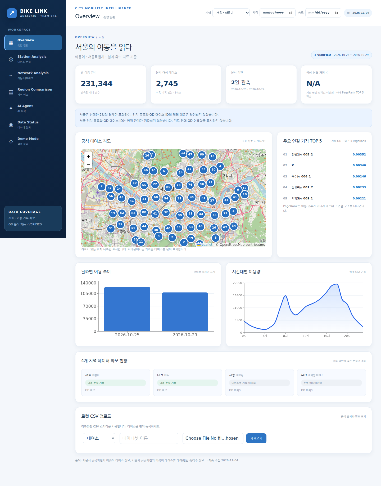
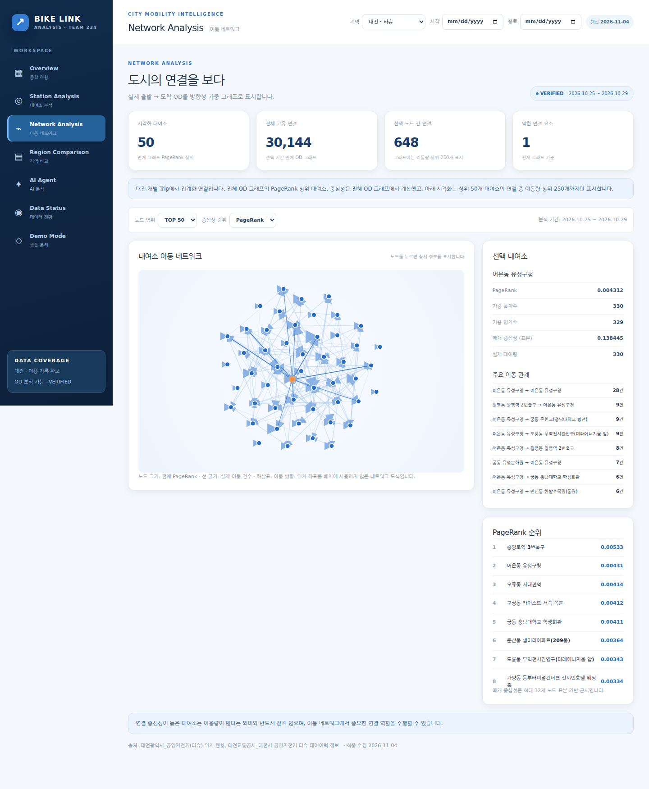
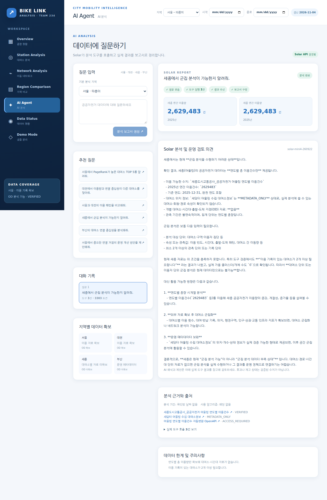
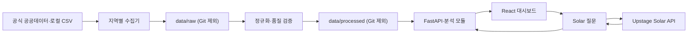

# Bike Link Analysis

**팀 234 · 공공자전거 이동 네트워크 분석**

서울·대전·세종·부산의 공공자전거 자료를 확보된 범위에서 분석하는 React + FastAPI 서비스입니다. 대여소 이용 패턴, 실제 출발·도착(OD) 연결, 지역별 자료 현황을 보여주고 Upstage Solar가 분석 도구의 결과를 근거로 보고서를 작성합니다. **자료가 없는 지표는 만들지 않으며**, 합성 샘플은 별도 Demo Mode에만 표시합니다.

## 화면 미리보기



*서울 Overview의 Stage 3 캡처입니다. 이 캡처는 Stage 4의 공식 대여소 ID 대응 전 화면이므로 현재 좌표 연결 상태와 다를 수 있습니다.*

| 이동 네트워크 | Solar 분석 보고서 |
|---|---|
|  |  |

[대전 Overview](docs/screenshots/stage3/overview-daejeon.png) · [지역 비교](docs/screenshots/stage3/comparison.png) · [자료 현황](docs/screenshots/stage3/data-status.png) · [모바일 화면](docs/screenshots/stage3/overview-mobile.png)

## 주요 기능

| 화면 | 제공 기능 |
|---|---|
| Overview | 관측된 이용량·기간·대여소, 지도, 날짜·시간대 차트, 연결 거점 |
| Station Analysis | 대여소 검색·선택, 군집 유형, 이용 패턴, 유사 대여소 |
| Network Analysis | 실제 OD 방향 그래프, PageRank·가중 입출차수·매개 중심성 |
| Region Comparison | 지역별 자료 범위와 비교 가능한 지표, 비교 한계 |
| AI Agent | Solar 도구 호출, 근거·출처·기간을 담은 구조화 보고서 |
| Data Status | 데이터셋 상태·품질·미확보 항목 |
| Demo Mode | 실제 분석과 분리한 합성 샘플 |

### 데이터 처리 구조



분석 모듈은 K-means 군집화, 코사인 유사도, NetworkX 방향 그래프와 중심성을 사용합니다. 네트워크 중심성은 **전체 OD 그래프**에서 계산하며, 화면에는 상위 노드와 간선만 표시합니다. AI 보고서의 구조화 카드·차트는 서버가 도구 결과로 만들고, Solar의 자유 서술은 별도로 보여줍니다. [에이전트 구조와 검증 경계](docs/SOLAR_AGENT_ARCHITECTURE.md)

## 현재 연결된 자료

| 지역 | 확인된 자료 | 분석 범위 |
|---|---|---|
| 서울 따릉이 | 2026-10-25·29 대여소별 OD 시간 집계, 공식 대여소 마스터 | 이용 패턴·군집·유사도·OD 네트워크·검증된 대여소 좌표 |
| 대전 타슈 | 대여소 목록, 같은 2일의 실제 대여이력 50,765건 | 이용 패턴·군집·유사도·Trip 기반 OD·지도 |
| 세종 어울링 | 2017~2025 연간 이용 건수 및 2026-08-31 부분 누계 | 연간 총량 |
| 부산 | 시청의 17개소 운영 현황 | 운영 메타데이터만 표시 |

서울 OD는 **개별 Trip이 아닌 집계**이고 대전은 개별 Trip을 집계합니다. 현재 두 지역의 분석 기간은 연속된 기간이 아닌 **2026-10-25와 2026-10-29, 단 2일**입니다. 총량을 도시의 장기 이용량처럼 해석하거나 두 지역의 모집단이 같다고 가정하면 안 됩니다. 세종·부산은 대여소 단위 기록과 OD가 없어 해당 분석을 제공하지 않습니다.

서울 OD ID 2,748개 중 2,747개는 공식 대여소 마스터의 ID와 직접 일치하고 유효 좌표가 확인됐습니다. 미확인 ID `X`는 지도·중심성 시각화에서 제외합니다. 공식 마스터의 **현재 좌표가 관측일에도 같았는지**는 추가 확인이 필요합니다. [ID 대응 검증](docs/SEOUL_STATION_ID_MAPPING.md) · [데이터 출처·라이선스·컬럼](docs/DATA_SOURCES.md) · [공통 데이터 형식](docs/data-contract.md)

## 로컬 실행

Python 3.11+와 Node.js 20+가 필요합니다. 저장소 루트에서:

```bash
python -m venv .venv
.venv/bin/pip install -r backend/requirements.txt
cp .env.example .env
.venv/bin/python -m scripts.collect.collect_all
.venv/bin/python -m scripts.preprocess.normalize
.venv/bin/python -m scripts.preprocess.map_seoul_stations
.venv/bin/python -m scripts.preprocess.validate_stage3
.venv/bin/uvicorn backend.main:app --host 127.0.0.1 --port 8000
```

새 터미널에서:

```bash
cd frontend
npm ci
npm run dev
```

Vite 주소는 보통 `http://localhost:5173`이며 `/api`를 FastAPI로 프록시합니다. `collect_all`은 공식 원본을 내려받으므로 네트워크·디스크 공간이 필요합니다. 서울 마스터 대응 명령은 공식 사이트에 다시 접속합니다. 수집이 어려우면 [출처 문서](docs/DATA_SOURCES.md)의 지역별 수집·로컬 파일 가져오기 방법이나 화면의 정규화 CSV 업로드를 사용하세요. 원본 및 처리 파일은 Git에 포함되지 않으므로 새 환경에서는 수집과 정규화를 다시 해야 합니다.

### API 키와 비밀 정보

`.env.example`을 복사한 **로컬 `.env`에만** 값을 입력합니다. `UPSTAGE_API_KEY`는 Solar 분석에, `DATA_GO_KR_API_KEY`는 공공데이터포털 자동변환 OpenAPI에 사용합니다. 키가 없으면 AI 채팅은 설정 안내를 반환합니다. 키 값은 브라우저로 전송하지 않으며 `.env`, 원본 데이터, 처리 데이터, 빌드 산출물은 `.gitignore`에서 제외합니다. `BIKE_DATABASE_URL`은 향후 전용 PostgreSQL 전환을 위한 예시이며 현재 서비스는 파일 기반입니다. 공공데이터포털 OpenAPI는 경로만 확인했고 인증 호출 결과는 아직 검증하지 않았습니다.

## API와 검증

주요 엔드포인트는 `GET /api/health`, `/api/regions`, `/api/regions/{region_id}/{overview|stations|clusters|network|centrality|similarity}`, `/api/compare`, `/api/data-sources`, `/api/data-quality`, `/api/data-validation`입니다. `POST /api/regions/{region_id}/upload`로 정규화 CSV를 가져올 수 있고, `POST /api/agent/chat`은 Solar 보고서를 반환합니다. 지역 및 비교 API는 `date_start`, `date_end`를 지원합니다. 합성 샘플 API는 `/api/demo/*`에만 있습니다. FastAPI 실행 후 `http://127.0.0.1:8000/docs`에서 스키마를 확인할 수 있습니다.

```bash
.venv/bin/python -m pytest backend/tests -q
cd frontend && npm run build
```

[Stage 3 화면·검증 기록](docs/DEVELOPMENT_LOG_STAGE3.md) · [Stage 4 Solar 테스트](docs/SOLAR_TOOL_TESTS.md) · [Stage 4 개발 기록](docs/DEVELOPMENT_LOG_STAGE4.md)
