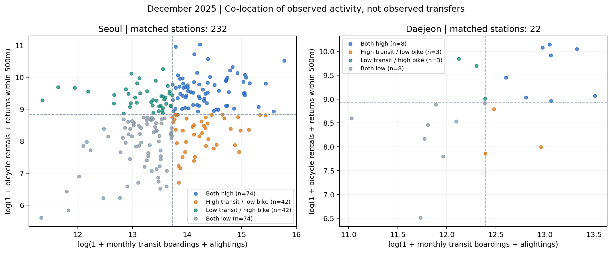

# 후보 선정 방법 검증

## 범위와 운영 데이터 분리

이번 산출물은 민감도 확장, 수요 사분면, 대여소 가림 후 재발견의 세 가지다. Louvain·군집 특징 재설계·계절 비교·도로망 전수 검증은 포함하지 않았다.

세 도시 공통 관측월 **2025-12-01~31**을 고정한 별도 실험이다. 현재 도시별 12/27/72개월 전체 기간 분석을 대체하지 않는다. 원본·분석 SQLite·KPI·전체기간 패킷은 읽기만 하며, 실험 결과는 data/reference/method_validation_202512.json에 별도 저장한다. 새 요청에서 재계산하지 않는다.

입력은 기존 공식 자료의 위치·앵커·시설·경계·인구·12월 OD 및 역별 승하차 산출물이다. 출처·시점은 [기존 자료 감사](ADDITIONAL_DATA_AUDIT.md)와 [정류장 출처](transit_stops_sources.md)를 따른다. 신규 자료를 다운로드하지 않았다. 위치·인구·시설 기준일과 이용월의 차이는 그대로 남는다. 세종은 동일 시 인구밀도를 구별 신호로 사용하지 않으며 인구 항목을 점수에서 제외한다.

## 1. 신규 입지 파라미터 민감도

운영 신규 후보와 같은 규칙: EPSG:5179 격자, 경계 내 대표점, 기존 대여소300m 밖, 주변1km 관측 대여 또는 시설500m 존재. 점수는 시설·주변수요·공백 비율의 도시 내 midrank 백분위 평균이며 서울·대전만 구 인구밀도를 추가한다. midrank=(낮은 값 수+동률 수/2)/후보 수. 판정은 반올림 전 전체 정밀도다.

연구용 빠른 구현은 정렬 기반 percentile과 공간검색을 사용한다. fixture에서 기존 grid_sites 전체 순위·점수를 대조하고, 실제 각 도시 기본 TOP10의 ID와 점수를 기존 사전 집계와 1e-12 허용오차로 확인했다. 운영 함수는 변경하지 않았다.

기준: 앵커500m·격자500m·균등가중·후보버퍼300m.
한 번에 한 요인을 변경한 총8조건:
- 앵커 반경300/500/800m.
- 격자250/500/750m.
- 균등/주변수요 우선/공백 우선. 우선 항목0.5, 나머지에0.5 균등 배분.
- 후보버퍼500m: **순위 입력이 아니라 공간 면적만 변경**. 순위 일치를 강건성 증거로 세지 않는다.

TOP10 exact Jaccard=교집합/합집합. 격자가 바뀌면 ID가 달라지므로 300m 이내 최대 일대일 위치 대응/기준 후보 수를 함께 제시한다. 공통 ID의 평균 순위 이동, 후보 수, TOP10 버퍼의 중복 제거 추가 면적도 저장한다.

그리드 변경 결과는 후보 수와 공간 이산화에 민감할 수 있다. 거리나 가중치를 바꾸어도 결과가 좋아질 것이라고 가정하지 않는다. 조합 전체를 전수 탐색한 실험이 아니라 one-factor-at-a-time 점검이다.

## 2. 대여소 가림 후 재발견

- 높은 이용량10개소 1회, 이용량3분위별 표본10개소 3회(seed42/43/44), 이용 대여소가 가장 많은1km 격자2개의 **이용 대여소 전수**를 각각 숨긴다. 모두 실제 관측·유효좌표·경계 내 대여소다.
- 숨긴 대여소를 마스터에서 제외하고, 출발 또는 도착이 해당 ID인 모든 OD를 제거한다.
- 남은 OD로 모든 대여소 대여·반납을 다시 집계한다. 원래 station_usage 합계를 후보 수요에 되돌려 넣는 fallback은 없다.
- 후보 생성·정규화·순위를 다시 계산한다. 숨긴 위치·이용량은 마지막 평가에만 사용한다. 앵커·시설·경계는 관측된 외생 자료로 보존한다.
- 후보 격자 위치와 가린 위치를 투영좌표상300m 이내 일대일로 대응한다. 최대 매칭 수를 먼저 최대화하고 거리를 최소화한다. 한 후보로 여러 목표를 복구한 것으로 세지 않는다.
- **Recall@10=복구된 목표 수/가린 전체 대여소 수**. 후보를 생성할 수 없는 목표도 전체 분모에 남긴다. 생성 가능한 후보가300m 안에 존재하는 목표 수와 그 조건부 recall은 별도 보조 지표다.
- 공간 fold의 N>10이면 recall 상한은10/N이다. 유형별 N·상한을 JSON에 기록한다. 도시·가림 유형이 다른 recall을 같은 난도의 성능으로 단순 평균하지 않는다.
- 비교 기준: 같은 가림 후 후보 풀에서 전체 점수 / 주변수요 순위만 / 시설·인구 순위만 / 무작위 TOP10 30회. 이는 **동일 후보 풀 안 순위 비교**이며 시설·인구만으로 후보 생성까지 독립 실행한 ablation은 아니다.
- fold의 중첩과 공간 의존성이 있어 반복 횟수를 독립 표본으로 간주한 신뢰구간을 만들지 않는다. 실험 조건·실패·낮은 값도 그대로 공개한다.

이 검증이 성공하더라도 기존 대여소 위치의 재발견만 평가한다. 신규 대여소 설치 후 수요·실제 환승·운영 개선 효과를 검증한 것은 아니다. 이용 상위 대여소가 교통 접근 공백 신규 설치 규칙과 맞지 않을 수 있으므로 전체 회복률과 후보 생성 가능률을 함께 읽어야 한다.

## 3. 대중교통 수요 × 자전거 활동

역별 월 승차+하차와 주변500m 자전거 대여+반납을 도시 내 중앙값으로 상/하 분류한다. 중앙값 동률은 높음, 자전거 활동0은 낮음이다. 역 승하차 합계0/결측은 실제 무수요를 확인할 수 없어 사분면 분류를 보류하고 행·이유를 공개한다. 서울 신내역의 기존 산출물 승하차0행이 해당한다. 원본 수요 API 자체는 수정하지 않는다.

500m 결과와300m 결과는 각 반경에서 중앙값을 별도로 계산해 같은 역의 사분면 유지 수를 표시한다. 인근 대여소 수·대여소당 활동을 함께 제공하며, ‘대중교통 높음/자전거 낮음’을 설치 필요나 미충족 수요로 확정하지 않는다.

- 양쪽 높음: 함께 집중된 관측 활동.
- 대중교통 높음/자전거 낮음: 자전거 연계 여건 추가 점검.
- 대중교통 낮음/자전거 높음: 지역 자전거 역할 추가 점검.
- 양쪽 낮음: 현재 비교 자료에서 활동 낮음.

같은 대여소가 여러 역 반경에 중복 포함되므로 역별 자전거 활동을 도시 총량으로 합산하지 않는다. 확보한 운영기관·연결역 범위에 한정되며 모든 노선을 대표하지 않는다. 세종은 같은 월 BRT 승하차량 미확보로 N/A를 유지한다. 차트는 읽기 쉬운 log(1+x) 축이며 분류는 원수치로 수행한다.

## 실행·화면

```bash
OPENBLAS_NUM_THREADS=1 OMP_NUM_THREADS=1 python -m scripts.validate.build_method_validation
python -m scripts.validate.plot_method_validation
python -m pytest backend/tests -q
python -m compileall -q backend scripts
cd frontend && npm run build
```

- GET /api/method-validation?city=seoul|daejeon|sejong|all
- 웹는 기존 읽기 전용 API 브리지 /bike-link-ui/api/method-validation을 이용한다. 장기 실행 중인 기존 web.call의 Python 캐시와 전체기간 맥락 변환에 의존하지 않는다.
- 개선 지역 찾기의 ‘후보 선정 방법 검증’에서 표·차트가 자동 표시된다. 웹는 자전거 이용 분석에서도 확인할 수 있다.
- 입력 revision·실험 코드·대중교통 산출물·기존 후보 코드의 SHA-256이 달라지면409. 다른 기간 결과로 대체하거나 요청 중 재계산하지 않는다.
- 브라우저: python -m scripts.validate.method_validation_browser (로컬 FastAPI8000·Vite5173·웹3000 필요, 모델 호출 없음).

[실측 결과 표](METHOD_VALIDATION_RESULTS.md) · [API 측정](METHOD_VALIDATION_API.json) · [브라우저 결과](method-validation-20261123/browser.json)



## 결과 해석 원칙과 다음 과제

격자 크기에 민감하거나 무작위·단순 수요 순위를 이기지 못하면 ‘방법이 검증되었다’고 보고하지 않는다. 현재 방법은 교통 공백·설치 간격 제약을 따르는 공간 후보 탐색이지 기존 인기 대여소를 재현하도록 학습한 수요 예측 모델이 아니다.

다음 단계에서는 가림 실험의 적용 대상 정의, 격자 이산화 영향, 후보 위치 매칭 기준을 사전 설계하여 개선하고 별도 기간에서 재평가한다. 기존 제한 문구를 지우거나 낮은 성능을 숨기지 않는다.

관련 근거: [공간·시간 구조 교차검증](https://freidok.uni-freiburg.de/data/135949), [JRC 민감도 지침](https://knowledge-for-policy.ec.europa.eu/composite-indicators/toolkit_en/navigation-page/10-step-guide_en/step-8-sensitivity-analysis_en).

## 후속 보완

[감사 항목별 수정·후속 코호트·지도/AI 연결·실행 결과](VALIDATION_GAPS_RESOLVED_20261123.md)를 참고한다. 원래 실패를 보존한 별도 코호트 평가, 조건별 반복 후보, 고정12월 상세·AI 맥락과 직접 접속 경로를 보완했다. 성능 검증 성공이나 실제 운영 효과 입증을 뜻하지 않는다.

## 추가 실행: 개발·평가 기간 분리

[실패 원인 분해·6월 개발/7월 별도 평가 진행 결과](RECOVERY_EVALUATION_PROGRESS.md)를 추가했다. 3도시×2월×3가림×2격자×4순위의144조건을 실행하고288개매칭 지표를 감사했다. 후보 생성 가능성이 늘어도 추천 성능이 전반적으로 개선되지는 않아 운영 점수는 유지했다. 원래12월실패 결과를 대체하지 않는다. 새 결과는 별도 문서·JSON으로 보존하며 현재 화면의 원래12월검증 수치를 바꾸지 않는다.
