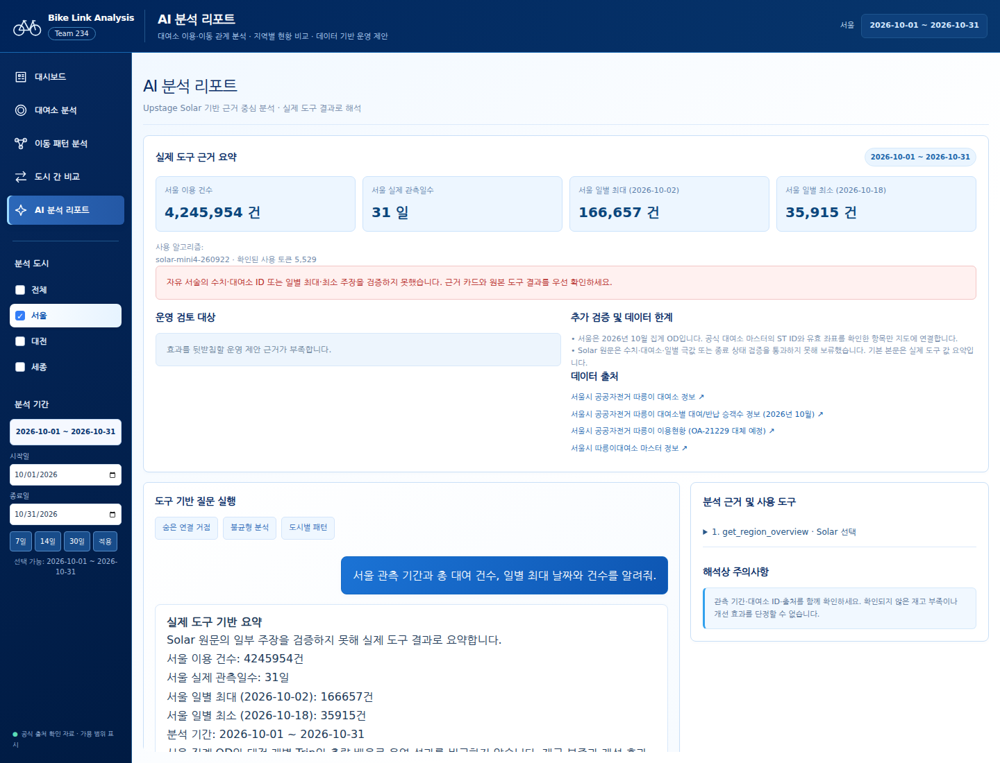
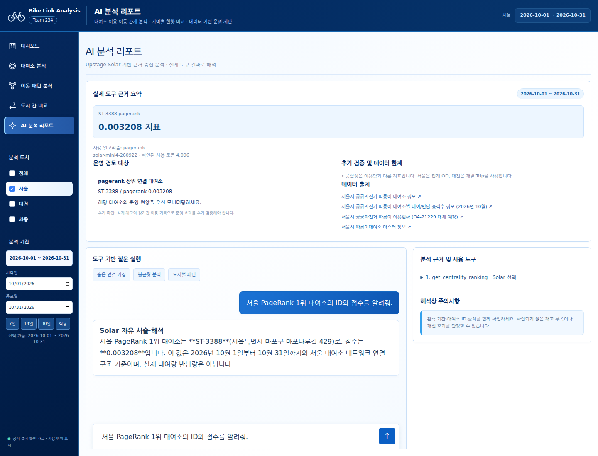
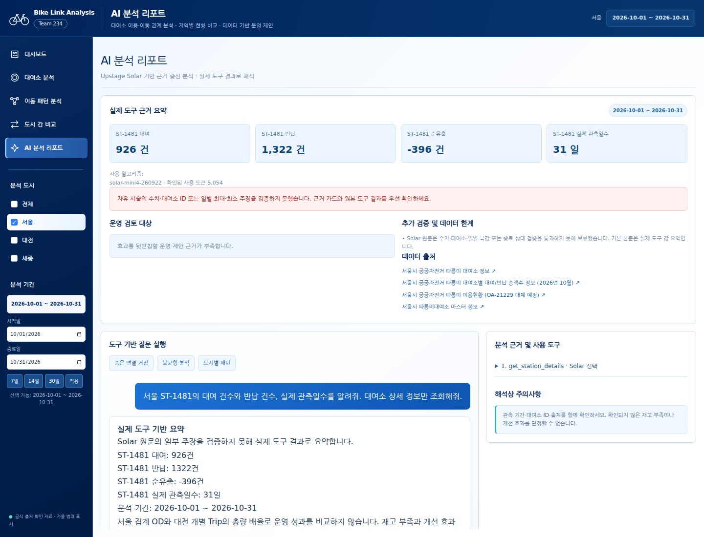

# Solar 검증 오류 수정 결과

2026-11-12 UTC / 리뷰 hpvgdafxkclbrixczgryxevuyzafjovb

PageRank의 중복 분석, 관측일수 오탐, 보류 후 수치 누락을 수정했다. 실제 Solar 호출에서 잘못된 최대·최소 설명을 차단하고 도구 값으로 표시하는 것을 확인했다. 실패 호출의 확인된 토큰과 미반환 사용량을 추적할 수 있도록 보완했다. **과거 실패 호출의 전체 청구량과 강의계획서와의 정확한 일치는 외부 자료가 없어 미해결이다.** PageRank 재확인은 4.790초에 성공했지만, 초기 동시 화면 요청 중 114.587초가 걸린 사례가 있어 최초 요청 지연의 완전 해소로 판정하지 않는다.

## 수정 내용과 실제 결과

| 항목 | 수정 | 확인 결과 |
|---|---|---|
| PageRank 시간 초과 | 숨은 거점·상위 연결 분석 중복 제거, PageRank에서 불필요한 표본 매개 중심성 제외. 기존 다른 지표의 기본 계산 유지 | 재확인 Q4 get_centrality_ranking 0.064초, 도구 선택과 최종 Solar 답변 포함 4.790초. ST-3388 / 0.003208 일치 |
| 외부 응답 시간 초과 | 요청별 최대 대기 45초, 남은 처리 예산 검사, 자동 재시도 0. 최종 답변 실패 시 이미 실행한 실제 도구 결과로 응답하고 incomplete 명시 | 실제 Q3 최종 모델 호출 시간 초과에도 대여 926·반납 1,322·관측 31일 카드/요약 유지. 최초 도구 선택 실패는 504와 계측 정보를 반환하도록 테스트 |
| 일별 최대·최소 오류 | 숫자 존재 여부 외에 날짜와 극값의 대응을 검사. 동률 허용, 판정 불가 비교는 보류. 실제 일별 최대·최소 카드 추가 | 실제 Q1 모델은 10-18 / 35,915를 최대라고 잘못 설명. 새 검증이 차단하고 실제 최대 10-02 / 166,657, 최소 10-18 / 35,915 표시 |
| 관측일수 오탐 | ISO 날짜의 구분자를 음수 부호와 분리. ST ID 별도 검증. observed_dates의 고유 날짜 수만 관측일수 근거로 허용 | 이전 실제 보류 원문 “31일”이 새 검사 통과. 이번 Q5도 31일 통과 |
| 기본 답변 수치 누락 | 상세 조회와 유사도 결과를 사실 카드에 반영 | ST-1481 대여 926·반납 1,322·순유출 -396·관측 31일 카드 4개 표시. 원문 보류/모델 실패 때도 유지 |
| 실패 토큰 추적 | 외부 호출 직전 pending, 응답 completed 또는 failed를 JSONL 기록. 단계·HTTP 상태·응답 ID·확인된 usage 기록 | 실제 9개 외부 호출 시도 중 HTTP 200 확인 8개, 응답 시간 초과 1개. 누락 사용량은 null / usage_complete=false |
| 추가 극값 오류 | 시간대 순유입·순유출의 시각/건수 최대 비교도 대조 | Q5 원문은 19시 59건을 최대 순유출로 서술했으나 실제는 22시 69건. 마지막 보호 함수 재생에서 원문 보류하고 기본 수치 유지 |

관측일수 수정은 날짜 숫자를 전부 무조건 허용하는 처리가 아니다. 실제 관측일 배열이 2개뿐이면 “31일 관측”은 계속 거절한다. 음수 순유출과 근거 없는 건수 거절도 회귀 테스트로 확인했다.

기존 최초 14개 도구에 다른 작업에서 추가한 정류장 연계 도구 2개가 있어 착수 당시 도구는 **16개**였다. 이번 수정은 16개를 모두 보존했다. 데이터·키·설정 모델·다른 작업의 변경을 삭제하지 않았다.

## 실제 실행과 비용

WIZ 실제 통합 페이지에서 질문을 입력하고 버튼으로 전송했다. 모델 요청 solar-mini4, 실제 응답 solar-mini4-260922. 제공자 개별 HTTP 상태와 응답 ID를 이번부터 직접 기록했다. 별도 연결 확인용 유료 요청은 하지 않았다.

| 실행 | 질문 목적 | WIZ 본문 code | 도구 | 결과 | 초 | 확인 토큰 |
|---|---|---|---|---|---:|---:|
| Q1 | 서울 기간·총 대여·일별 최대 | 200 | get_region_overview | 모델 극값 오류 차단, 도구 요약 표시 | 4.562 | 5,529 |
| Q2 | 서울 PageRank 1위 ID·점수 | 200 | get_centrality_ranking | 최초 분석 지연, 추가 모델 호출 중단 후 도구 요약 / incomplete | 114.587 | 2,388 |
| Q3 | ST-1481 대여·반납·관측일 | 200 | get_station_details | 최종 제공자 시간 초과, 도구 요약 / incomplete | 46.846 | 2,379 + 미반환 |
| Q4 | PageRank 표적 재확인 | 200 | get_centrality_ranking | Solar 최종 답변 완료, ST-3388 / 0.003208 일치 | 4.790 | 4,096 |
| Q5 | 관측일 표적 재확인 | 200 | get_station_details | 요청한 926 / 1,322 / 31일 일치. 부가 시간대 비교 오류는 최종 보호에서 보류 | 16.953 | 5,054 |

Q4·Q5는 초기 화면 네트워크 요청이 끝난 상태에서 실시한 표적 재확인이다. 최초 요청 성능으로 제시하지 않는다. 추가 재확인은 해당 실패를 확인하기 위한 각 1회로 한정했고 SDK 내부 재시도는 하지 않았다.
이번 확인 토큰은 **입력 18,761 + 출력 685 = 19,446**이다. Q3 실패 호출 사용량이 없으므로 청구 총량은 이보다 클 수 있다. 이전 검증의 13,150토큰 및 과거 다른 리뷰의 사용량과 합산하지 않는다.

### 실패 사용량의 처리
- 성공한 도구 선택 호출의 usage를 최종 호출 실패 때도 보존한다.
- 실패 호출에 토큰 0을 기입하지 않는다. 호출별 usage=null이며 합산 usage는 **확인된 하한**이다.
- usage_complete는 모든 시도에서 usage를 받았는지 표시한다. 모델 답변의 완료 여부는 llm_status로 별도 표시한다.
- 원본 추적: bike-link-analysis/data/solar-audit/YYYY-MM-DD.jsonl. 키·헤더·질문·메시지 본문은 기록하지 않는다. 신규 로그 파일 권한은 0600이다.
- 요청 ID·단계·시각으로 미반환 호출을 식별할 수 있다. 정확한 청구량은 Upstage 계정 사용 내역과 대조해야 한다.
- 과거 실패 Q2는 제공자 응답 ID·usage가 저장되지 않았다. 이번 로깅으로 과거 값을 복원하거나 전체 청구량을 임의 산정하지 않는다.

## 근거 수치 검증

SQLite를 읽기 전용으로 조회하여 서울 10월 총 4,245,954건, 일별 최대 2026-10-02 / 166,657건, ST-1481 대여 926 / 반납 1,322를 확인했다. 기존 actual 원문과 이번 실제 응답을 회귀 입력으로 사용했다. 별도 캐시 우회 단일 프로세스에서 PageRank 계산은 4.009초, profiles는 2.635초였다. 이 측정은 WIZ 동시 요청의 최초 대기 시간을 설명하거나 보장하지 않는다.

Q4는 도구 값·최종 답변의 ST-3388 / PageRank 0.003208이 일치한다. Q5는 요청된 핵심 값이 일치하고 관측일수 오탐은 해소됐다. 단, 추가 문장에 발생한 시간대 최대 오류를 그대로 정상 판정하지 않고 새 보호 로직으로 재생해 보류했다.

## 화면과 로그

- [실제 유료 호출 로그](solar-recovery-20261112/live.json): 5개 질문의 실제 WIZ 응답, 도구 인자·결과, 모델 답변, 토큰·시간.
- [호출별 감사 로그](solar-recovery-20261112/audit.json): 9개 호출의 pending/completed/failed, 제공자 HTTP와 응답 ID.
- [최종 보호 재생 및 SQL 대조](solar-recovery-20261112/replay-checks.json): 실제 응답을 마지막 코드에 재적용. 추가 Solar 요청 0개.
- [전체 백엔드 테스트 원문](solar-recovery-20261112/pytest.txt): **46 passed, 2 warnings in 15.36s**.
- [최종 WIZ 빌드](solar-recovery-20261112/build.json): 일반 빌드 성공, errors=null.
- 브라우저 실제 호출 pageerror 0개.

### 실제 Q1 최대 오류 차단

### 실제 Q4 PageRank 최종 응답

### 최종 Q5 보호 화면 재생

마지막 화면은 Q5 실제 원문을 최신 보호 함수에 재적용하고 WIZ의 chat 응답만 가로채 표시한 **재생 검증**이다. 새 Solar 실호출 또는 최종 코드에서 모델 답변의 완전 정확성 증명으로 집계하지 않는다. Q5의 실호출 당시 화면은 별도 q5.png에 보존했다.

## 강의 알고리즘 대조 준비

프로젝트 파일·문서에서 강의계획서나 교수님 지정 알고리즘 목록을 찾지 못했다. 사용자에게 목록을 요청했으며 현재 응답이 없다. 아래는 구현 증거이며 **수업에서 배운 알고리즘이라는 인증은 아니다.**

| 대조할 항목 | 현재 구현 근거 | 현재 확인 범위 | 강의 일치 |
|---|---|---|---|
| 군집화 | backend/analysis/clustering.py / StandardScaler, KMeans | 기존 분석·회귀 테스트 | 자료 필요 |
| 군집 평가 | 같은 파일 / Silhouette, Adjusted Rand Index | 품질 경고·기간 비교 테스트 | 자료 필요 |
| 그래프 분석 | backend/analysis/network.py / 가중 PageRank·차수·표본 매개 중심성 | 이번 PageRank 실호출·값 대조 | 자료 필요 |
| 유사도 | backend/analysis/similarity.py / cosine similarity | 이전 실호출·독립 수식 계산 기록 유지 | 자료 필요 |
| 대용량 집계 | scripts/preprocess/spark_tashu.py / PySpark 그룹 집계·중복 처리 | 기존 Spark 산출물·차집합 검증 기록 확인, 이번 전체 배치 재실행 없음 | 자료 필요 |

[기존 Spark 배치 설명](SPARK_TASHU_PIPELINE.md), [기존 Spark 검증 결과](transit/spark-validation.json)를 참고하면 교수님이 지정한 항목을 빠르게 연결할 수 있다. 강의 자료 없이 수업 조건 충족으로 서명하거나 무관한 알고리즘을 추가하지 않는다.

## 재현과 남은 조건

- 무료: python -m pytest backend/tests -q
- 무료 보호/화면 재생: python scripts/validate/solar_recovery_replay.py
- 유료 검증: python scripts/validate/solar_recovery_browser.py. 이미 시도한 ID는 반복하지 않는다. live.json을 삭제하면 다시 비용이 발생한다.
- 외부 응답 실패 자체와 최초 분석의 장시간 대기는 계속 가능하다. 로컬 도구 계산을 강제로 종료하는 타이머는 추가하지 않았다. 현재 처리 예산 검사는 계산 뒤 추가 모델 요청을 중단하는 방식이다.
- 수치·일별/시간대 일부 극값 검사는 자유 서술 전체의 의미를 보장하지 않는다. 판정 실패 시 기본 수치 카드를 우선 표시한다.
- 과거/이번 미반환 요청의 정확한 청구량에는 Upstage 계정 사용 내역이 필요하고, 수업 조건 대조에는 강의계획서 또는 지정 알고리즘 목록이 필요하다.
- Git push·배포·서버 재시작은 하지 않았다. WIZ 일반 빌드와 현재 로컬 통합 화면을 확인했다.
