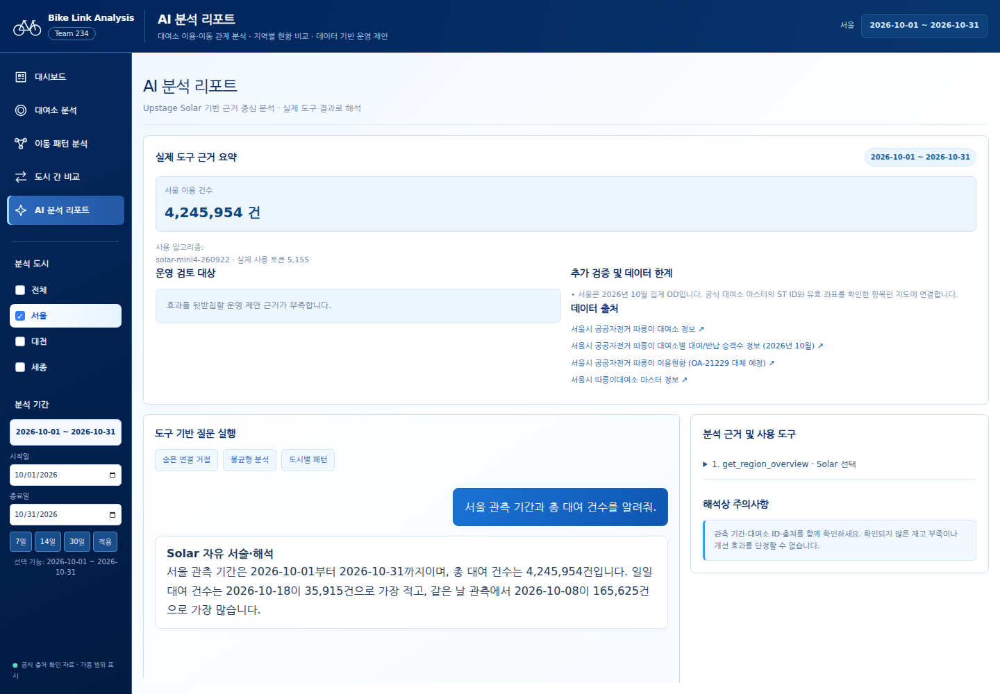
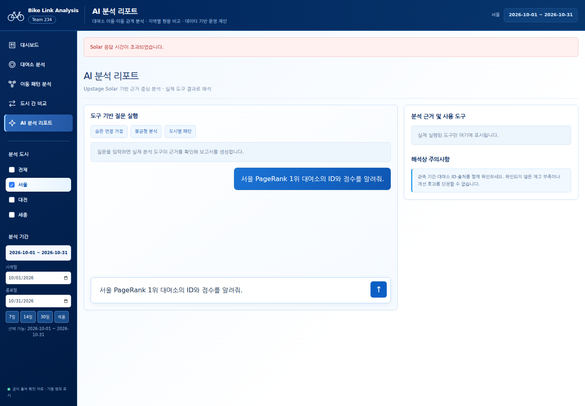
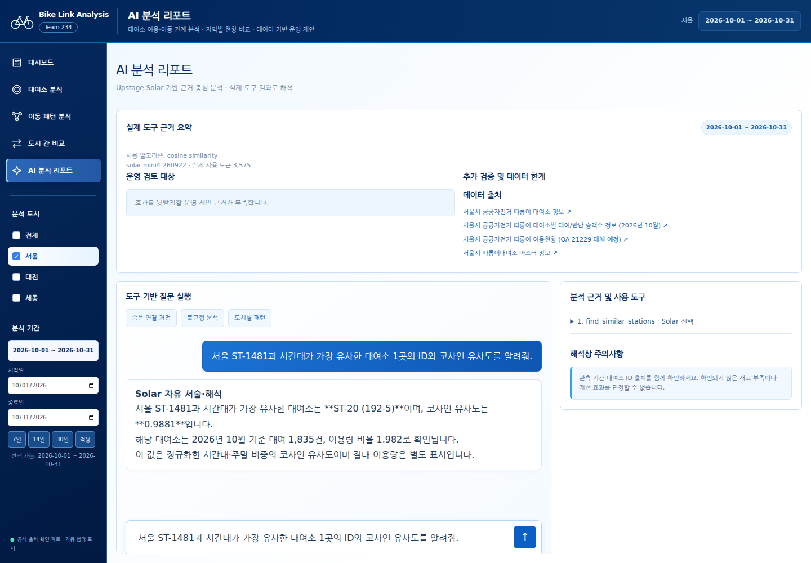
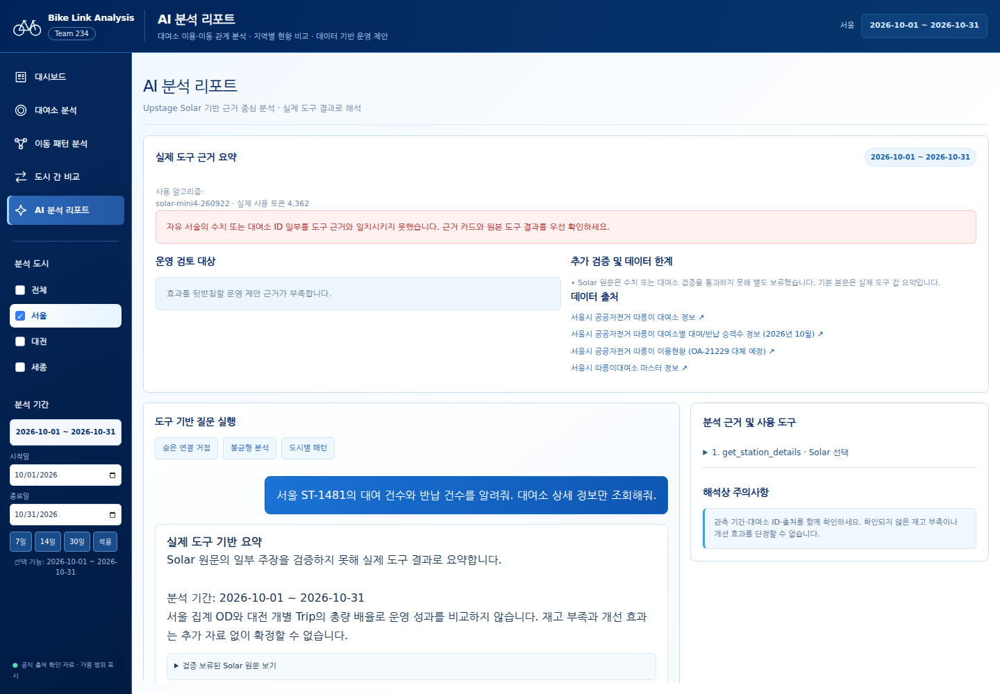

# Bike Link Analysis — Upstage Solar 최종 검증

> 이 문서는 수정 전 최초 검증 기록입니다. 후속 수정·재확인 결과는 [Solar 검증 오류 수정 결과](SOLAR_RECOVERY_20261112.md)를 확인하세요. 최초 실행 로그는 비교 근거로 보존합니다.
- 리뷰: hpvgdafxkclbrixczgryxevuyzafjovb / 김민주
- 실행일: 2026-11-12 UTC. 현재 WIZ 프로젝트: main.
- 검증 범위: 현재 Solar 에이전트와 14개 도구 보존, 실제 API 접근·도구 실행·답변 근거·WIZ 화면 검증.
- **최종 판정: 부분 성공. API 실접근과 LLM의 실제 도구 호출은 증명했다. 모든 답변의 정확성과 정상 완료는 증명하지 못했으며 실제 실패를 발견했다.**
- 기존 다른 리뷰의 5개 질문·89,772토큰 기록은 이번 실행 실적으로 합산하지 않았다.

## 1. 교수님 필수 조건 판정
| 조건 | 확인한 증거 | 판정 |
|---|---|---|
| 빅데이터 알고리즘 사용 | backend/analysis/clustering.py의 StandardScaler·KMeans·Silhouette·ARI, network.py의 가중 PageRank·차수·표본 매개 중심성, similarity.py의 코사인 유사도 확인. 이번 Q3는 코사인 유사도를 실제 실행하고 독립 계산과 대조. Q4 상세 조회에 실제 군집 결과 포함 | 구현·일부 실행 확인. 강의계획서가 없어 “수업에서 배운” 알고리즘과의 정확한 일치는 별도 확인 필요 |
| 분석 도구를 호출하는 LLM 에이전트 | 실제 WIZ 응답 evidence의 initiator=solar로 get_region_overview / find_similar_stations / get_station_details 호출 확인 | 성공 |
| Upstage Solar 및 실제 API 접근 | api.upstage.ai 직접 POST HTTP 200, 응답 모델 solar-mini4-260922. WIZ 성공 응답도 같은 모델명 | 성공 |

## 2. 환경·모델·HTTP
- UPSTAGE_API_KEY: .env 로드 후 테스트 프로세스에서 설정 여부 true만 확인했다. WIZ의 실제 인증 성공으로 서비스에서도 사용 가능함을 확인했다. 키 값·일부 문자열·길이·Authorization 헤더는 기록하지 않았다.
- .env 위치: bike-link-analysis/.env. 파일 내용은 보고서에 포함하지 않는다.
- 설정 모델: UPSTAGE_MODEL 또는 기본값 solar-mini4. 이번 환경의 적용 모델은 solar-mini4.
- 제공자 실제 응답 모델: **solar-mini4-260922**.
- 요청: POST https://api.upstage.ai/v1/chat/completions.
- 별도 연결 확인 1회: “Reply OK.” / max_tokens=16 / HTTP **200** / 0.488초 / 종료 stop.
- 연결 확인 응답 ID: 74b7cac6-24c2-4995-9e95-43e3590d957e.
- 직접 제공자 HTTP 상태는 execution.json의 provider_probe.http_status에 보관했다.
- WIZ 요청의 전송 HTTP와 본문 code는 다르다. Q2는 HTTP 200이지만 본문 code=504이며 실패다.
- WIZ 내부 각 Upstage 요청의 HTTP 상태·응답 ID는 기존 에이전트가 반환하지 않는다. 직접 확인 요청의 HTTP 200을 모든 내부 호출의 개별 HTTP 기록으로 대체 해석하지 않는다.

## 3. 실제 WIZ 실행
주소: http://localhost:3000/course/aafa5691f92f40e89818200a14c98a90?public=1
실제 요청 경로: /wiz/api/component.bike.link/handle, action=chat.
Playwright Chromium으로 실제 페이지의 질문 입력·전송 버튼을 사용했다. 응답 모킹·저장 응답 재생은 하지 않았다.
모든 질문의 선택 범위는 서울 / 2026-10-01~2026-10-31이다.

| Q | 실제 질문 | 전송 HTTP / 본문 code | Solar 선택 도구 | 결과 | 초 |
|---|---|---|---|---|---|
| 1 | 서울 관측 기간과 총 대여 건수를 알려줘. | 200 / 200 | get_region_overview | 도구 성공·표시 성공, 추가 최댓값 해석 오류 | 3.924 |
| 2 | 서울 PageRank 1위 대여소의 ID와 점수를 알려줘. | 200 / 504 | 실패 응답에 evidence가 없어 확인 불가 | 화면에 Solar 응답 시간 초과 안내, 답변 없음 | 44.708 |
| 3 | 서울 ST-1481과 시간대가 가장 유사한 대여소 1곳의 ID와 코사인 유사도를 알려줘. | 200 / 200 | find_similar_stations | 도구·답변 수치 및 ID 일치 | 4.766 |
| 4 | 서울 ST-1481의 대여 건수와 반납 건수를 알려줘. 대여소 상세 정보만 조회해줘. | 200 / 200 | get_station_details | 도구·원문 수치 일치, 검증기 오탐으로 기본 답변 누락 | 5.383 |

3개 질문에서 실제 도구 실행 evidence를 확보했다. Q2의 실패를 보존하고 재시도 대신 Q4 한 건을 추가했다. 성공 3건은 각 1개 도구를 Solar가 선택했으며 서버 metric_guard 보강은 없었다. Q2가 어느 단계에서 실패했고 도구가 실행됐는지는 응답으로 증명할 수 없으므로 이름을 추정 기재하지 않는다.
성공 응답 3건 모두 model_finish_reason=stop이다.

### 실행 과정과 근거 전달
1. WIZ가 region_ids/date_start/date_end와 질문을 기존 chat 함수에 전달한다.
2. Solar 첫 completion은 14개 도구 스키마와 tool_choice=required를 받는다.
3. Solar tool_calls의 이름·JSON 인자를 서버 run_tool이 검증하고 실제 로컬 분석 함수를 실행한다.
4. 도구의 result를 role=tool 메시지로 Solar에 전달한다. 서버 근거 보강은 initiator=metric_guard로 구분한다.
5. 두 번째 completion은 tool_choice=none으로 최종 답변을 만든다.
6. finalize_answer가 수치 토큰·ST ID·길이 종료를 검사한다. WIZ는 최종 본문·보류 원문·출처·도구 근거를 표시한다.

실제 성공 인자:
- Q1: get_region_overview(region_id="seoul", date_range={date_start:"2026-10-01", date_end:"2026-10-31"})
- Q3: find_similar_stations(region_id="seoul", station_id="ST-1481", top_n=1, 같은 date_range)
- Q4: get_station_details(region_id="seoul", station_id="ST-1481", 같은 date_range)

## 4. 수치·ID·기간 대조
검증 스크립트는 외부 API 없이 SQLite 읽기 전용 SQL과 별도 코사인 수식으로 대조했다.

| 질문/항목 | 도구·독립 계산 | Solar 원문 / 기본 표시 | 판정 |
|---|---|---|---|
| Q1 총량·기간 | 4,245,954건 / 2026-10-01~31 / 31일 | 총량과 시작·종료일 일치 | 성공 |
| Q1 일별 최솟값 | 10-18 / 35,915건 | 동일 | 성공 |
| Q1 일별 최댓값 | **10-02 / 166,657건** | **10-08 / 165,625건이 가장 많다** | 실패 |
| Q2 PageRank | 실패 응답에 결과 없음 | 답변 없음 | 미검증 |
| Q3 유사 대여소 | ST-20, 이름 192-5 / 0.9881 | ID·이름·점수 일치 | 성공 |
| Q3 부가 수치 | ST-20 대여 1,835 / ST-1481 대비 비율 1.982 | 동일, 2026년 10월 명시 | 성공 |
| Q4 상세 | ST-1481 구파발역 환승센터 / 대여 926 / 반납 1,322 / 순유출 -396 / 관측 31일 | 보류 원문에 동일 값. 기본 본문은 요청한 대여·반납 수치 없음 | 원문 주요 값 성공, 기본 답변 실패 |

Q1 도구의 31개 daily 행은 SQL 집계와 모두 일치했다. 오류는 도구 계산이 아니라 Solar의 최대 비교 주장이다. 기존 숫자 검사에서 15/15 토큰 일치·station_validation 통과했지만, “이미 존재하는 숫자”를 잘못된 최댓값으로 설명하는 의미 오류는 통과했다.

Q3는 시간대 대여 비율 24개와 주말 비중의 벡터로 dot/(norm*norm)을 계산하고 모든 대상 대여소를 정렬했다. 독립 계산 1위 ST-20 / 0.9881로 일치했다. 이는 시간대·주말 패턴 유사도이며 물리적 인접성이나 이동 연결을 뜻하지 않는다.

Q4의 보류 이유는 unmatched_numeric_tokens=["31","31"]이다. 실제 observed_dates는 31개이며 원문의 “10월 1~31일 총 31일”은 타당하다. 검증기가 문자열 날짜의 수치·배열 길이를 처리하는 방식 때문에 맞는 관측일수도 미일치로 판단한다. 또한 get_station_details에 대한 기본 요약 카드가 없어 보류 후 수치가 빠졌다. 실제 화면과 원문을 함께 보관했으며 이 문제를 정상 완료로 판정하지 않았다.

## 5. 토큰·비용 제한
| 실행 | 입력 | 출력 | 확인된 합계 |
|---|---:|---:|---:|
| 직접 HTTP 확인 | 55 | 3 | 58 |
| Q1 | 5,039 | 116 | 5,155 |
| Q2 시간 초과 | 미반환 | 미반환 | 미확인 |
| Q3 | 3,438 | 137 | 3,575 |
| Q4 | 4,192 | 170 | 4,362 |
| **확인된 합계** | **12,724** | **426** | **13,150** |

13,150은 확인된 하한이며 Q2에 과금된 토큰이 있을 수 있다. 실패 시 기존 chat이 usage를 반환하지 않아 전체 청구량은 산정할 수 없다. 사용자 과금 내역 접근은 하지 않았다. 가격을 추정한 금액도 기록하지 않았다.
성공 질문은 각각 외부 completion 2회이므로 성공 확인 요청은 6회 + 직접 HTTP 확인 1회 = 7회다. Q2는 코드상 추가 1~2회 외부 시도가 가능하며 개별 응답 로그가 없어 총 외부 시도는 8~9회 범위로만 추정한다. SDK max_retries=0이며 이번 검증은 실패 질문을 재시도하지 않았다. 별도 분석 결과 대조에는 외부 요청 0회다.

## 6. WIZ 화면 증거
실제 WIZ에서 성공 답변 3건·각 도구 이름·출처 4개 렌더링, 실패 1건의 시간 초과 안내를 확인했다. 브라우저 pageerror 0건이다.
유사도·대여소 상세는 기존 _report에 전용 key_findings 생성 분기가 없어 두 응답의 수치 카드는 0개다. 도구 근거 패널에는 실제 결과가 있다. 화면이 로드된 사실을 모든 질문의 정상 답변으로 해석하지 않는다.

### Q1: 도구·총량 표시, 최댓값 오류

### Q2: 시간 초과

### Q3: 유사도 일치

### Q4: 원문 보류·기본 수치 누락

## 7. Solar가 없을 때의 수작업과 자동화 범위
| 분석 단계 | 사람이 직접 수행할 작업 | 현재 Solar 흐름 |
|---|---|---|
| 질의 해석 | 질문에서 도시·기간·대여소 ID·분석 목적을 추출하고 메뉴/함수를 선택 | 자연어 질문에서 적합한 도구와 인자를 제시, 서버는 화면 선택 조건을 강제 |
| 이용량 확인 | SQLite 기간 필터·일별 합계·총합을 직접 조회 | Q1에서 개요 도구를 선택하고 실제 합계·일별 근거를 확보 |
| 유사 대여소 | 시간대 벡터·주말 비중을 준비하고 코사인 유사도를 계산·정렬, ID와 수치를 옮김 | Q3에서 유사도 도구를 호출하고 ST-20 / 0.9881을 설명 |
| 대여소 상세 | ID를 검색해 대여·반납·좌표·군집·관측 기간을 조회·합침 | Q4에서 상세 도구 호출·원문 설명. 기본 요약은 검증기 오탐으로 미완성 |
| 중심성·군집 | OD 그래프 구성·PageRank 또는 정규화·K-means 실행 후 결과 해석 | 분석 함수는 구현돼 있으나 이번 Q2는 시간 초과로 최종 자동화 성공 증명 불가 |
| 보고서 작성 | 수치·출처·한계와 해석을 따로 복사·정리 | 답변·출처·근거 패널을 자동 표시. 최댓값 의미 검토와 실패 대응은 사람이 필요 |

Solar는 자연어에서 도구 선택→분석 함수 실행 연결→근거 해석·표시를 자동화한다. 실제 계산은 로컬 분석 모듈이 수행한다. Solar 없이도 기존 분석 메뉴·함수는 이용할 수 있으나 질의에 맞는 함수를 고르고 결과를 비교·서술하는 작업이 필요하다. 데이터 수집 자체, 강의 조건 충족 판정, 분석 정확성 전부를 Solar가 자동 보증하지 않는다. 실제 시간 절감량은 측정하지 않았다.

## 8. 기존 14개 도구 유지
get_region_overview, get_station_details, get_station_clusters, get_centrality_ranking,
get_network_analysis, find_similar_stations, compare_region_patterns, get_data_availability,
get_cluster_stability, get_station_imbalance, get_hidden_hubs, get_hidden_hub_validation,
get_station_role_history, get_role_candidates.

이번에 14개 전체를 유료 호출한 것은 아니다. solar.py, wiz_bridge.py, WIZ api.py/view.ts/view.pug의 시작·종료 SHA-256이 동일함을 확인했다. 애플리케이션 코드·모델 설정·키·14개 도구를 변경하지 않았다.

## 9. 재현 및 증거 파일
- [실제 실행 원본 JSON](solar-verification-20261112/execution.json): UTC 시각, 모델, 제공자 HTTP, 토큰, WIZ 상태, 도구 인자·응답·최종 답변, 소스 해시.
- [SQL·코사인 대조 결과](solar-verification-20261112/evidence-checks.json): 실제 실패 판정도 포함.
- [기존 보호 테스트 결과](solar-verification-20261112/guard-tests.json): 실행 명령과 2 passed / 5 deselected / 경고 2건.
- scripts/validate/review_solar.py: 결과 파일에 없는 질문만 실행, 기존 provider_probe 보존. 저장 파일을 삭제하고 실행하면 비용 발생.
- scripts/validate/review_solar_evidence.py: 기존 실제 응답과 로컬 데이터만 비교. 외부 요청 없음.
- 실행: python scripts/validate/review_solar.py
- 무료 대조: python scripts/validate/review_solar_evidence.py
- 기존 보호 검증: python -m pytest backend/tests/test_final_review.py -q -k 'solar or truncated'
- 문서·검증 스크립트·실행 산출물만 추가했다. 서비스 소스 변경이 없어 빌드·배포·서버 재시작은 수행하지 않았다.

## 10. 남은 문제와 교수님께 제시할 결론
1. **실제 API 접근: 성공.** 제공자 HTTP 200 및 실제 모델명·응답 ID를 제시할 수 있다.
2. **실제 분석 도구 호출: 성공.** 3개 질문에서 initiator=solar인 실제 도구 응답을 제시할 수 있다.
3. **도구 근거 기반 답변: 부분 성공.** Q3 일치, Q1 총량·기간 일치지만 최대 비교 오류. Q4 원문 핵심 값은 일치하나 기본 화면에서 누락됐다.
4. **수작업 자동화: 확인.** 질의 해석·도구 선택·계산 함수 연결·근거 설명 및 출처 표시를 자동화했다.
5. **최종 완전 정상 동작: 실패.** Q2 시간 초과, Q1 의미 검증 누락, Q4 검증기 오탐·요약 누락이 남는다. 이번 요청은 검증이므로 해당 구현을 임의 수정하지 않았다.
6. 이번 최소 호출은 서울 한 기간 중심이다. 대전·세종·14개 도구 전체·외부 공개 호스트·모바일의 이번 실호출 검증은 수행하지 않았다. 강의계획서와의 알고리즘 일치도 미확인이다.
