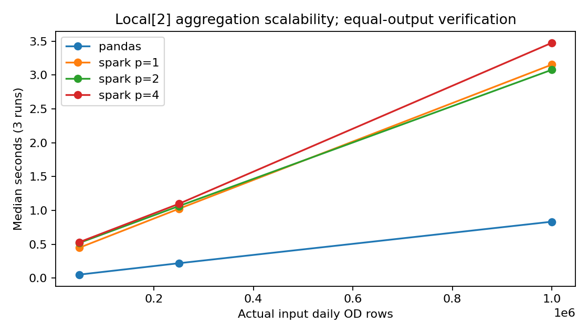

# 입지 최적화·불확실성·설명 모델·처리 성능·AI 평가

2026-11-23. 기존 운영 점수·후보 순위·원본·공통/개별 분석 DB를 보존한 별도 오프라인 연구이다. 기존 화면에 접이식 결과를 추가했으며 신규 메뉴는 만들지 않았다.

## 범위와 주요 결과

- 전체 선택: 세 도시 공통 2025-12-01~2025-12-31. 개별: 서울 2025년 12개월, 대전 2024-08~2026-10 27개월, 세종 2020~2025년 72개월. 기간이 다른 총량은 합산하지 않는다.
- 6개 범위 × 2개 목적 × K=1/2/3 = 36개 MCLP 인스턴스를 PuLP 3.3.2/CBC로 해결했고 모두 solver 로그에서 최적성 증명을 확인했다. 같은 설치 수의 점수순·탐욕·MCLP 108행 비교는 [CSV](comparisons.csv)에 있다.
- 관측 날짜별 앵커 근접 OD 비중에 연월별 구성 고정·연속 주블록 부트스트랩 구간을 계산했다.
- 설명 모델은 시간 홀드아웃에서 서울·대전은 단순 기준모델보다 오차가 컸고 세종은 작았다. 결과를 그대로 공개하며 운영 예측 도구로 사용하지 않는다.
- 36회 pandas/Spark 실측에서 출력 해시가 모두 일치했다. 이 집계 단계에서는 pandas가 빨랐다.
- 기존 Solar 실응답 6개 재평가 및 새 12호출(3도시×근거유무×2회)을 완료했다. 인용 경로의 값·단위·기간 일치와 field ID 형식을 별도로 평가했다.
- 재배치 최소 비용 계획은 과거 재고·거치 용량·목표 재고 부재로 구현하지 않았다. 기존 재배치 검토를 유지한다.

## A. MCLP 정의와 비교

`max Σ w_i y_i`, `y_i ≤ Σ a_ij x_j`, `Σ x_j = K`, `x_j,y_i ∈ {0,1}`. 각 수요/공간 원자는 한 번만 계산한다.

- 면적 목적: 앵커500m 밖·행정경계 안 후보300m 버퍼의 정확한 교차 다각형 원자 면적. EPSG:5179, 기존64변 버퍼 표현, 원자 합계와 전체 합집합 면적 일치 검사.
- 수요 목적: 후보1km 이내 기존 대여소의 관측 대여량을 대여소별 한 번만 계산한다. **주변 관측 수요 대리변수이며 신규 설치 수요·300m 접근 가능 인구가 아니다.**
- 축소: 도시 전역의 기존 적격 격자에서 앵커1,500m 이내·추가 면적 양수만 남긴다. 점수 상위20+2km 타일 대표 최대40, 나머지 점수순으로 최대60개를 구성한다. 세 방법 모두 같은 축소 후보 집합을 사용한다.
- 원래 전체 후보 집합이나 실제 설치 부지의 전역 최적해를 주장하지 않는다. 거리 상한·축소 규칙은 실험 조건이며 추가 민감도 검증이 필요하다.
- CBC time limit45초·gapRel0·threads1. PuLP 상태 문자열만 보지 않고 CBC 로그의 최적성 증명을 확인한다. 증명 없는 시간제한 해에는 최적해 달성률을 붙이지 않는다.

| 개별 도시 | 원래 후보 | 거리 조건 후 | 최적화 후보 | K=3 점수 면적(km²) | 최적 면적(km²) | 점수/면적 최적 | 점수/주변수요 최적 |
|---|---:|---:|---:|---:|---:|---:|---:|
| 서울 | 839 | 663 | 60 | 0.824530 | 0.846868 | 97.36% | 25.67% |
| 대전 | 487 | 53 | 53 | 0.824530 | 0.846868 | 97.36% | 30.04% |
| 세종 | 198 | 96 | 60 | 0.846868 | 0.846868 | 100.00% | 31.76% |

**해석:** 모든 실측 인스턴스에서 탐욕법도 같은 목적의 MCLP 최적값에 도달했다. 따라서 이 자료에서 MCLP가 탐욕법보다 낫다고 주장하지 않는다. 일반적으로 같다는 보장도 없으며, 테스트에는 탐욕이 17·정확해가22인 독립 반례가 있다. 면적 목적은 겹치지 않는 완전 버퍼3개를 고를 수 있어 동률이 많다. 기존 점수는 인구·시설·공백 등을 함께 고려하므로 수요 단일목적 대비 비율만으로 기존 방법 전체를 실패로 판정하지 않는다.

## F. 날짜별 변동 95% 구간

연월별 관측일 수를 고정한 paired moving-block bootstrap, 주블록7일·2,000회·seed42. 실제 연속 달력일 창만 사용하여 누락일을 잇지 않고 0으로 채우지 않는다. 각 재표본의 `연계 건수 합 / 전체 건수 합`을 계산한다. 3/14일 블록 각1,000회 민감도도 JSON에 보관했다.

| 범위 | 도시 | 비중 | 하한 | 상한 | 관측일/달력일 |
|---|---|---:|---:|---:|---:|
| 공통12월 | 서울 | 62.342% | 62.172% | 62.516% | 31/31 |
| 공통12월 | 대전 | 29.336% | 28.905% | 29.872% | 31/31 |
| 공통12월 | 세종 | 75.355% | 75.069% | 75.513% | 31/31 |
| 개별전체 | 서울 | 61.537% | 61.461% | 61.613% | 365/365 |
| 개별전체 | 대전 | 27.327% | 27.196% | 27.413% | 817/822 |
| 개별전체 | 세종 | 73.205% | 73.103% | 73.344% | 2189/2192 |

관측된 기록은 표본조사가 아니므로 이 구간을 전체 기록 집계의 오차 범위라고 해석하지 않는다. 관측 날짜 구성을 바꿨을 때의 변동 범위이며, 실제 환승률·미래 구간·좌표/자료 누락 편향을 보증하지 않는다. 월내 블록 끝점의 표본확률 차이와 고정 참조자료의 시점 차이는 남는다.

## C. 관측 수요 설명 모델

도시 관측일×대여소의 일별 대여량을 설명한다. 훈련 기간 이용량만으로 고이용·좌표 연결 50곳을 선정하고, 모든 대여소를 같은 날짜 경계에서80/20으로 나눈다. Poisson HistGradientBoosting(80회·early stopping 없음), 입력은 앵커 거리·정류장 수·시설 수·위경도·요일·월 sin/cos·경과일이다. 미래 대여량·전체기간 이용량·PageRank는 입력하지 않았다.

동일 기간의 상세 승하차·날씨·과거 재고는 입력에서 제외했다. 도시 미관측일은 제외하며 대여소별 행 부재는0으로 가정했다. 과거 개폐소일·대여소별 누락을 구분하지 못한다.

| 도시 | 훈련 종료 | 검증 시작 | 모델 MAE(건/일) | 대여소 훈련평균 MAE | 판단 |
|---|---|---|---:|---:|---|
| 서울 | 2025-10-19 | 2025-10-20 | 68.786 | 63.726 | 기준보다 오차 큼 |
| 대전 | 2026-05-20 | 2026-05-21 | 60.327 | 44.867 | 기준보다 오차 큼 |
| 세종 | 2024-10-19 | 2024-10-20 | 12.797 | 16.657 | 해당 검증 구간 오차 작음 |

홀드아웃 permutation importance(5회·최대5,000행), 부분 의존 곡선(훈련5~95% 분위·검증 최대2,000행)을 공개한다. 중요도·부분 의존은 인과효과가 아니다. 상관된 공간변수에 따른 중요도 분산·비현실적 조합 외삽이 가능하며, 고이용50곳의 동일 지역 시간 검증이 신규 지역 일반화를 입증하지 않는다.

[서울 그림](model-seoul.png) · [대전 그림](model-daejeon.png) · [세종 그림](model-sejong.png)

## D. 실제 처리 시간

대전 개별 DB의 실제 일별 OD 행을 rowid순 prefix로 추출했다. 5만/25만/100만 **집계 행**이며 원본 Trip 수로 표현하지 않는다. 같은 CSV를 월별 OD SUM으로 집계하고 pandas/Spark 출력 그룹 수·건수·정렬 해시를 확인했다. 각3회, Spark local[2], 파티션1/2/4.

| 실제 일별 OD 행 | pandas 중앙값(초) | Spark p=1 | Spark p=2 | Spark p=4 |
|---:|---:|---:|---:|---:|
| 50000 | 0.052 | 0.449 | 0.520 | 0.532 |
| 250000 | 0.220 | 1.024 | 1.064 | 1.097 |
| 1000000 | 0.834 | 3.154 | 3.078 | 3.476 |

JVM 시작 5.267초, 워밍업 3.751초를 별도로 기록했다. 본 시간은 CSV 읽기·집계·결과 구체화를 포함하고 체크섬 계산은 제외한다. OS 파일 캐시는 비우지 않았다. Python/Java RSS는50ms 간격으로 측정했으며 상세 환경·최소/최대 시간·메모리는 [원본 측정](benchmark.json)에 있다.

**이 단계·크기에서는 pandas가 빨랐다.** 분산 클러스터나 전체 원본 정규화 성능·모든 크기의 우열을 주장하지 않는다. 파티션 수 변화는 CPU/노드 수 확장과 구분한다.



## E. Solar 평가

기존 실응답6개는 새 API 호출 없이 재평가했다. 새 실측은3도시×근거 유무×2회=12호출, 확인된 총 5,360토큰이다. 실제 저장 도구의 수치가 포함된 렌더러와 같은 질문의 무근거 조건을 비교했다. 자율 도구 선택 전체나 통계적 우월성 검정으로 해석하지 않는다.

| 조건 | 응답 수 | 필요한 사실 응답률 | 수치 토큰 일치 | 인용 경로 값/단위/기간 일치 | exact field ID 준수 |
|---|---:|---:|---:|---:|---:|
| 근거 미제공 | 6 | 0.0% | 100.0% | 미측정/분모없음 | 미측정/분모없음 |
| 실제 도구 근거 | 6 | 100.0% | 100.0% | 100.0% | 0.0% |

무근거 조건은 모두 답변을 보류했다. 이것은 오답이 아니라 안전한 미응답이며 수치 토큰100%만 보고 성능이 좋다고 판단하면 안 된다. 근거 조건의 수치·단위·기간·명시적 evidence 경로는 일치했지만 field를한국어 설명으로 출력해 exact ID 형식 검사는0%였다. 내용 정확도와 프로토콜 형식 준수를 분리하고 평가 프롬프트의 field ID 명세를 더 명확히 할 필요가 있다.

평가 후 새 유료 호출 없이 저장 응답을 재채점했다. exact field 검사와 evidence 경로의 값/단위/기간 검사를 각각 보존했다. 한국어 필드를 임의로 정답 ID로 바꾸지 않았다. 수치 토큰 검사에는 사전 지정 질문 파라미터K=3을 포함한다.

실응답에서 근거 불일치인 구조화 주장 분모는 없어 미검증 보류율은 미산출이다. 자유 서술 전체의 정답 주석도 없으므로 의미 전체의 분리율을 주장하지 않는다. 값/단위/기간/가공 필드 오류4개 통제 사례와 비정상 JSON 참조에 대한 회귀 테스트를 별도로 남겼다. [실응답·평가](agent-evaluation.json)

## 검증·연결·보존

- FastAPI GET /api/advanced-research 및 Solar get_advanced_research. 기간이 다르면422, 미준비·변경 입력은409. 요청에서 최적화/학습을 실행하지 않는다.
- 기존 웹/React 개선 화면의 접이식 비교와 K/목적 선택, 대시보드 변동 구간·AI 질문을 추가했다. 공통/개별 범위를 유지한다.
- 백엔드195개 통과. 독립 완전탐색과 정확해 대조, 탐욕 반례, 중복 수요, PuLP 오표기 방지, 월 구성/달력 공백, 단위/기간/인용/출력 형식, 범위 고정 및 미재계산을 검증했다.
- 웹/React 빌드, 공개 web 전체/3도시·모바일 및 React3도시 화면 확인. [브라우저 기록](browser.json).
- 기존 공통 분석 파일5개의 SHA-256·수정시각·크기가 같고 기존 공통16조합128집계·개별52개씩의 배포 준비 검증도 통과했다. 운영 점수·후보·원본·DB 삭제/초기화 없음.
- Git 커밋/푸시·별도 배포 명령·운영 서비스 재시작 없음. 현재 프로젝트 빌드와 공개 화면 반영 확인.

## 재현

프로젝트 bike-link-analysis 디렉터리에서, 기존 검증 원본/정규화/참조 자료를 보존한 상태로 실행한다. 새 실험은 고정된 입력의 체크포인트만 재사용하며 입력 변경 시 기존 실험을 보관하고 새 실험 버전으로 계산한다.

```bash
python -m pip install -r backend/requirements.txt
OPENBLAS_NUM_THREADS=1 OMP_NUM_THREADS=2 python -m scripts.validate.build_advanced_research
python -m scripts.validate.benchmark_advanced_spark
python -m scripts.validate.evaluate_advanced_solar  # 기존 실응답 재채점, 새 호출 없음
# 새 유료 실험을 의도한 경우만: --live --max-calls 12 --repeats 2
python -m scripts.validate.export_advanced_research
python -m pytest backend/tests -q
python scripts/deploy/release.py --verify-only
```

Spark 실행에는 기존 requirements-spark.txt와 Java가 필요하다. 대용량 CSV 중간 산출물 data/advanced_benchmark는 Git 제외한다. first-pass 폴더는 달력 공백·월 구성 보강 전의 내부 초안이며 최종 결과로 사용하지 않는다.

## 남은 작업

1. 재배치: 과거 재고·거치 용량·목표 서비스 수준 확보 후에만 실제 최소 비용 계획 산출.
2. 입지: 축소 후보/거리 상한 민감도·현장 설치 가능성·실제 도로망 접근성 검증. 공간 최적성이 실제 설치 효과를 입증하지 않음.
3. 설명: 고해상도 인구·동일 시점 시설·날씨·정류장 수요·과거 개폐소 자료 보강, 일반 이용/저이용 및 공간 홀드아웃 확대.
4. 처리: 다른 집계/정규화 단계·더 큰 입력·실제 클러스터 별도 측정. Spark 속도 우위를 전제하지 않음.
5. AI: field ID 명세 강화·자율 도구 선택 실험·사람이 주석한 자유 서술 정답셋 확보. 소규모12호출로 일반적인 정확도 우월성 주장 금지.
